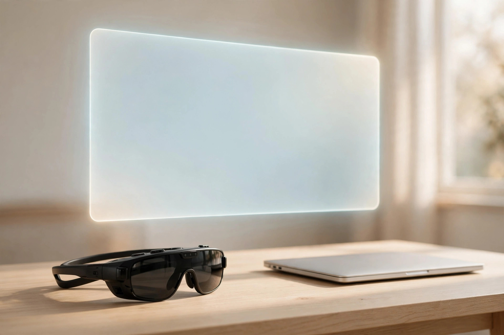
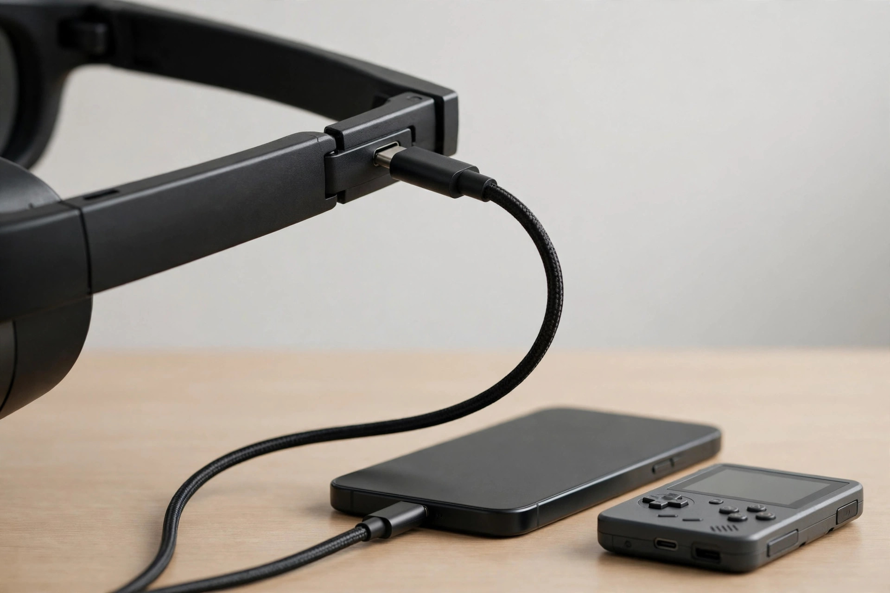

<!-- 본문 시작 -->
Open a laptop on a train seat and the person next to you glances over, while the screen itself feels small. What if a single pair of glasses could put a large screen right in front of your eyes? The **XREAL One Pro** is a pair of display glasses you wear like ordinary glasses: connect one USB-C cable and a virtual screen appears before you. What follows is based on official materials and independent reviews, not a hands-on test.

171 inches is the size converted for a viewing distance of 4 meters. The actual screen sits inside the lenses. (Illustration)

## What It Is

The XREAL One Pro is XREAL's flagship display glasses, announced in December 2024 and released in 2025. According to the official product page (checked 2026-11-09), a 0.55-inch Sony micro-OLED sits in front of each eye, showing 1920×1080 per eye at up to 120 Hz. In short, it is a monitor you wear. It has no battery, no processor of its own, and no camera. Its job is to take the screen of a connected device and show it large through the lenses. Despite the "AR glasses" name, it does not overlay information onto the real world; it puts a screen in front of your eyes.

## Three Standout Features

First, the wide field of view. Thanks to XREAL's newly developed X Prism flat-prism optical system, the field of view reaches 57°, and the screen can appear as large as 171 inches at a distance of 4 meters. TechRadar's review (June 2025) confirmed that this optical system reduces reflections from outside light, making the picture clearer.

Second, the screen stays where you put it. The X1 chip built into the glasses senses head movement and offers an Anchor mode that fixes the screen in one place and a Follow mode that moves it gently with your gaze, with no app or extra adapter. The screen does not swing around when you turn your head, which makes watching films on a train or a plane comfortable. The 3 ms latency figure is the manufacturer's own number.

Third, brightness and sound. Perceived brightness reaches up to 700 nits (official specification, checked 2026-11-09), and an electrochromic dimming function adjusts the lens tint so the screen stays visible in bright places. Sound comes from Bose-tuned speakers, though TechRadar advises using headphones while traveling, since sound from the speakers can leak to the next seat.

In bright places, dimming must be switched on for the screen to stay clear. Speaker sound can leak to the next seat, so headphones are needed. (Illustration)

> Key takeaway
>
> ### **Glasses, yet a 171-inch screen. But that screen needs a cable and a compatible device.**

## Drawbacks and Things to Check

First, it is wired. With no battery, it draws power from the connected device and only works with devices that support USB-C DisplayPort Alt Mode. If you are unsure whether your laptop or phone supports DP output, check before buying. The Nintendo Switch needs a separate hub.

Resolution is worth noting too. The picture is 1920×1080 per eye — full HD, not 4K. TechRadar also called the lack of 4K "the only remaining gripe." If you plan to read text on a large screen for long stretches, buy knowing it is 1080p.

There are extra costs as well. Full 6DoF spatial anchoring and photo and video capture need the separate XREAL Eye accessory ($99). Tom's Hardware's review (18 June 2025) found the Eye's image quality disappointing. Prescription lens inserts are also sold separately.

Finally, interpupillary distance (IPD). The One Pro comes in two sizes: M (57–66 mm) and L (66–75 mm). If you do not know your IPD, have it measured at an optician before buying. The wrong size can make the edges of the screen look blurry.

A single cable carries both power and the video signal. Check first whether the device you plan to connect supports USB-C DP output. (Illustration)

## Price and Availability in Korea

The launch price was $649, but the XREAL US official store lists it at $599 as of 2026-11-09. One complication has appeared: on 15 October 2026, the successor XREAL 1 Pro+ launched at the same $599 with a brighter screen. The 1 Pro+ reaches up to 1,200 nits (versus 700 nits on the One Pro), adds AI HDR and 60 fps 2D-to-3D conversion, and keeps the same core specifications as the One Pro.

Official pricing, sales channels, and after-sales terms in Korea have not been confirmed. For reference, the 1 Pro+ was introduced at a Korean hands-on event on 30 October 2026 at around 848,000 KRW (Ruliweb report). Buying the One Pro from overseas means customs duties and shipping are extra, and the dollar price must be converted at the exchange rate on the day of purchase.

## The Editor's Take

This fits people who travel often and watch films or work on a laptop, handheld console, or smartphone. A train or plane seat becomes a private cinema, and a café becomes a place to work on a large screen without worrying about onlookers. That is why TechRadar gave it 4.5 out of 5 and called it the best AR glasses for entertainment it had reviewed.

If you are buying new now, though, compare the 1 Pro+ first rather than paying for the One Pro straight away — the 1,200-nit difference matters more the brighter your surroundings are. If the One Pro appears at a discount, it can still be a good choice for buyers who put price before brightness. If you mostly use it outdoors in bright light, want 4K picture quality, or find the prescription insert cost adds too much, think once more before buying.

## Key Facts

| Item | Details |
|---|---|
| Product | XREAL One Pro (XREAL, wired display glasses) |
| Display | Sony 0.55-inch micro-OLED, 1920×1080 per eye, up to 120 Hz |
| Field of view / screen | 57°, up to 171 inches at 4 m (manufacturer basis) |
| Brightness | Up to 700 nits (perceived brightness, manufacturer basis) |
| Weight / connection | 87 g, USB-C (DP Alt Mode required), no battery |
| Price | $599 at the US official store (checked 2026-11-09; launch price $649) |
| Availability in Korea | Not confirmed |

## Recommended Reading

- [A Touchscreen on a USB Hub — Dockcase 7-in-1, What to Check Before Buying](https://aitechnotesen.wordpress.com/2026/11/08/a-touchscreen-on-a-usb-hub-dockcase-7in1-what-to-check-before-buying/) — A hub with a screen and glasses that become a screen: two ways to widen the display on your desk.
- [Fold It Shut and the Lens Closes — OBSBOT Meet Flip, What to Check Before Buying](https://aitechnotesen.wordpress.com/2026/11/08/fold-it-shut-and-the-lens-closes-obsbot-meet-flip-what-to-check-before-buying/) — What to check when choosing a camera for video calls.
- [주간 AI 뉴스 모음｜매주 AI 소식, 한 번에 따라가기](https://blog.naver.com/3700708/224464427593) — A weekly roundup to follow AI news in one place.

## Sources

- [XREAL One Pro official product page](https://www.xreal.com/one-pro/)
- [XREAL US official store — XREAL One Pro](https://us.shop.xreal.com/products/xreal-one-pro?currency=USD&variant=51684067279215&utm_source=google&utm_medium=cpc&utm_campaign=Google%20Shopping&stkn=0f9732f755eb&srsltid=AfmBOoqVbibRD-C0bBxRiMAp6cEA7tA4079FAUdKG4dcqhrBkDJgG-SyOHc)
- [TechRadar — Xreal One Pro review](https://www.techradar.com/computing/virtual-reality-augmented-reality/xreal-one-pro-review)
- [Tom's Hardware — Xreal One Pro review](https://www.tomshardware.com/peripherals/wearable-tech/xreal-one-pro-review)
- [XREAL 1 Pro+ official page](https://www.xreal.com/1-pro-plus)
- [Techaeris — XREAL 1 Pro+ launch report](https://techaeris.com/2026/10/18/xreal-1-pro-upgrades-the-flagship/)
- [Ruliweb — XREAL 1 Pro+ Korea hands-on event report](https://m.ruliweb.com/news/read/231320)
<!-- 본문 끝 -->
