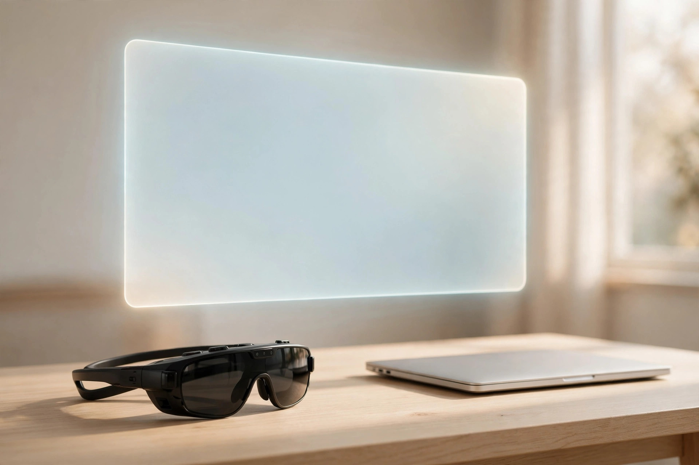
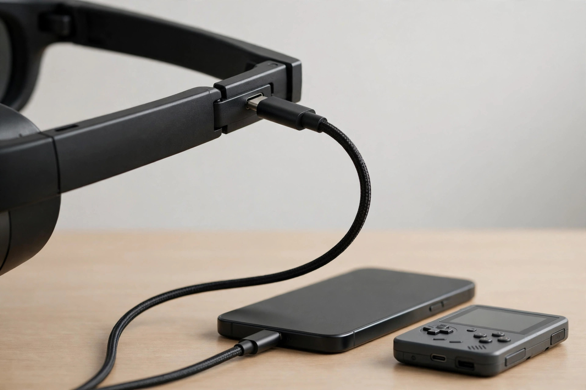

<!-- 본문 시작 -->
기차 좌석에서 노트북을 펼치면 옆 사람 시선이 신경 쓰이고 화면은 작기만 합니다. 안경 하나만으로 눈앞에 커다란 화면을 띄울 수 있다면 어떨까요. 오늘 소개할 **XREAL One Pro**는 안경처럼 쓰고 USB-C 케이블 하나만 연결하면 눈앞에 가상 화면을 띄워주는 디스플레이 글래스입니다. 아래 내용은 공식 자료와 독립 리뷰를 바탕으로 정리한 것으로, 직접 사용한 후기가 아닙니다.

171인치는 4m 거리에서 봤을 때의 환산 크기입니다. 실제 화면은 렌즈 안에 들어 있습니다. (일러스트)

## 제품의 정체

XREAL One Pro는 XREAL이 2024년 12월 발표하고 2025년 출시한 플래그십 디스플레이 글래스입니다. 공식 제품 페이지(2026-11-09 확인)에 따르면 소니 0.55인치 마이크로 OLED를 양쪽 눈에 넣어 눈당 1920×1080, 최대 120Hz로 화면을 보여줍니다. 한마디로 '입는 모니터'입니다. 배터리도, 자체 프로세서도, 카메라도 없습니다. 연결한 기기의 화면을 렌즈를 통해 크게 보여주는 것이 본업입니다. 'AR 글래스'라는 이름이지만 현실 위에 정보를 겹치는 방식이 아니라 눈앞에 화면을 띄우는 제품입니다.

## 눈에 띄는 특징 세 가지

첫째, 시야가 넓습니다. XREAL이 새로 개발한 X Prism 평면 프리즘 광학계 덕분에 시야각이 57°까지 넓어졌고, 4m 거리 기준으로 최대 171인치 크기의 화면이 보입니다. TechRadar 리뷰(2025년 6월)는 이 광학계가 바깥 빛의 반사를 줄여 화면이 더 또렷해졌다고 확인했습니다.

둘째, 화면이 제자리에 고정됩니다. 안경에 내장된 X1 칩이 고개 움직임을 감지해 화면을 한곳에 고정하는 앵커 모드와 시선을 따라오는 팔로우 모드를 앱이나 별도 어댑터 없이 제공합니다. 고개를 돌려도 화면이 함께 돌아가지 않으니 기차나 비행기에서 영화를 볼 때 편안합니다. 지연 시간 3ms는 제조사 수치입니다.

셋째, 밝기와 소리입니다. 체감 밝기는 최대 700니트(공식 사양, 2026-11-09 확인)이고, 렌즈 밝기를 전자식으로 조절하는 디밍 기능이 있어 밝은 곳에서도 화면을 볼 수 있습니다. 소리는 Bose 튜닝 스피커가 담당하는데, TechRadar는 여행 중에는 헤드폰을 함께 쓰라고 조언합니다. 스피커 소리가 옆 좌석까지 새어 나갈 수 있기 때문입니다.

밝은 곳에서는 디밍을 켜야 화면이 또렷해집니다. 스피커 소리는 옆 좌석까지 새어 나갈 수 있어 헤드폰이 필요합니다. (일러스트)

> 핵심 한 줄
>
> ### **안경인데, 화면이 171인치입니다. 단, 그 화면을 띄우려면 케이블과 호환되는 기기가 필요합니다.**

## 아쉬운 점과 확인할 점

먼저 유선이라는 점입니다. 배터리가 없어 연결한 기기에서 전원을 끌어오고, USB-C DP 출력(DisplayPort Alt Mode)을 지원하는 기기에만 연결됩니다. 내 기기가 DP 출력을 지원하는지 모른다면 구매 전에 반드시 확인해야 합니다. 닌텐도 스위치는 별도 허브가 필요합니다.

해상도도 짚어야 합니다. 화면은 눈당 1920×1080, 즉 풀HD이고 4K는 아닙니다. TechRadar도 "4K가 아닌 점이 유일한 아쉬움"이라고 적었습니다. 큰 화면에서 글자를 오래 읽을 용도라면 1080p라는 점을 알고 사야 합니다.

추가 비용도 있습니다. 화면을 공간에 완전히 고정하는 6DoF와 사진·영상 촬영은 별도 액세서리인 XREAL Eye(99달러)가 있어야 합니다. Tom's Hardware 리뷰(2025년 6월 18일)는 Eye의 화질이 아쉽다고 평가했습니다. 도수 렌즈 인서트도 별도 구매입니다.

마지막으로 동공 간 거리(IPD)입니다. One Pro는 M(57–66mm)과 L(66–75mm) 두 가지 사이즈로 나옵니다. 자기 동공 간 거리를 모르면 안경원에서 재고 사는 것이 안전합니다. 사이즈가 맞지 않으면 화면 가장자리가 흐릿해질 수 있습니다.

케이블 한 줄이 전원과 영상 신호를 함께 나릅니다. 연결할 기기가 USB-C DP 출력을 지원하는지 먼저 확인해야 합니다. (일러스트)

## 가격과 국내 이용

가격은 출시 당시 649달러였으나, XREAL 미국 공식 스토어에서는 2026-11-09 기준 599달러에 판매되고 있습니다. 여기에 변수가 생겼습니다. 2026년 10월 15일, 같은 599달러에 화면이 더 밝아진 후속 모델 XREAL 1 Pro+가 출시됐기 때문입니다. 1 Pro+는 최대 1,200니트(One Pro는 700니트)에 AI HDR과 60fps 2D→3D 변환을 더했고, 나머지 핵심 사양은 One Pro와 같습니다.

국내 정식 판매 가격과 판매 채널, A/S 조건은 확인하지 못했습니다. 참고로 1 Pro+는 2026년 10월 30일 국내 체험회에서 약 84만 8천 원 선으로 소개됐습니다(루리웹 보도). 직구 시 관세와 배송비는 별도이며, 달러 가격은 구매 시점 환율로 계산해야 합니다.

## 에디터의 판단

자주 이동하면서 노트북이나 휴대용 게임기, 스마트폰으로 영화와 작업을 보는 분께 어울리는 제품입니다. 기차·비행기 좌석이 나만의 영화관이 되고, 카페에서는 남의 시선 없이 큰 화면으로 일할 수 있습니다. TechRadar가 총점 4.5/5를 주며 오락용으로 최고라고 평가한 이유도 여기에 있습니다.

다만 지금 새로 산다면 One Pro를 바로 결제하기보다 같은 값의 1 Pro+와 먼저 비교하는 것이 좋습니다. 밝은 곳에서 주로 쓸수록 1,200니트의 차이가 크게 느껴질 수 있기 때문입니다. 반대로 One Pro가 할인된 가격에 나온다면 가격을 우선하는 분께는 좋은 선택이 될 수 있습니다. 밝은 야외에서 주로 쓰거나 4K 화질을 원하는 분, 도수 렌즈 인서트 비용까지 합치면 부담스러운 분은 한 번 더 생각해 보시길 권합니다.

## 핵심 정보

| 항목 | 내용 |
|---|---|
| 제품명 | XREAL One Pro (XREAL, 유선 디스플레이 글래스) |
| 디스플레이 | 소니 0.55인치 마이크로 OLED, 눈당 1920×1080, 최대 120Hz |
| 시야각·화면 | 57°, 4m 기준 최대 171인치 (제조사 기준) |
| 밝기 | 최대 700니트 (체감 밝기, 제조사 기준) |
| 무게·연결 | 87g, USB-C (DP Alt Mode 필요), 배터리 없음 |
| 가격 | 미국 공식 스토어 599달러 (2026-11-09 확인, 출시가 649달러) |
| 국내 판매 | 미확인 |

## 함께 보면 좋은 글

- [허브에 터치스크린을 달았다 — Dockcase 7-in-1, 사기 전에 확인할 조건](https://blog.naver.com/3700708/224468837400) — 화면이 달린 허브와 화면이 되는 안경, 책상 위 디스플레이를 넓히는 두 가지 방법을 비교해 보세요.
- [접으면 렌즈가 닫힌다 — OBSBOT Meet Flip, 사기 전에 확인할 조건](https://blog.naver.com/3700708/224468837113) — 화상회의 카메라를 고를 때 확인해야 할 조건을 정리한 글입니다.
- [주간 AI 뉴스 모음｜매주 AI 소식, 한 번에 따라가기](https://blog.naver.com/3700708/224464427593) — 매주 AI 소식을 한 번에 따라갈 수 있는 모음 글입니다.

## 출처

- [XREAL One Pro 공식 제품 페이지](https://www.xreal.com/one-pro/)
- [XREAL 미국 공식 스토어 — XREAL One Pro](https://us.shop.xreal.com/products/xreal-one-pro?currency=USD&variant=51684067279215&utm_source=google&utm_medium=cpc&utm_campaign=Google%20Shopping&stkn=0f9732f755eb&srsltid=AfmBOoqVbibRD-C0bBxRiMAp6cEA7tA4079FAUdKG4dcqhrBkDJgG-SyOHc)
- [TechRadar — Xreal One Pro 리뷰](https://www.techradar.com/computing/virtual-reality-augmented-reality/xreal-one-pro-review)
- [Tom's Hardware — Xreal One Pro 리뷰](https://www.tomshardware.com/peripherals/wearable-tech/xreal-one-pro-review)
- [XREAL 1 Pro+ 공식 페이지](https://www.xreal.com/1-pro-plus)
- [Techaeris — XREAL 1 Pro+ 출시 보도](https://techaeris.com/2026/10/18/xreal-1-pro-upgrades-the-flagship/)
- [루리웹 — XREAL 1 Pro+ 국내 체험회 보도](https://m.ruliweb.com/news/read/231320)
<!-- 본문 끝 -->
