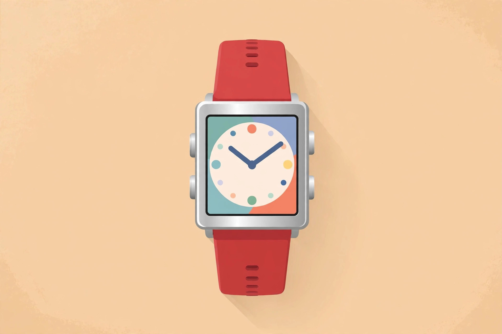
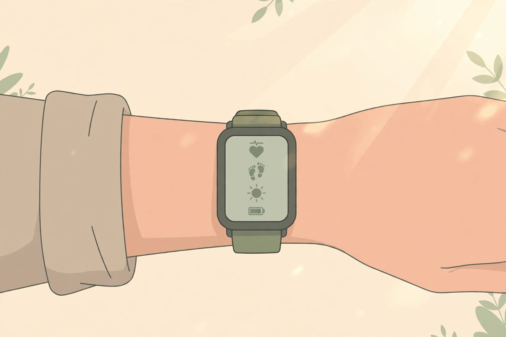
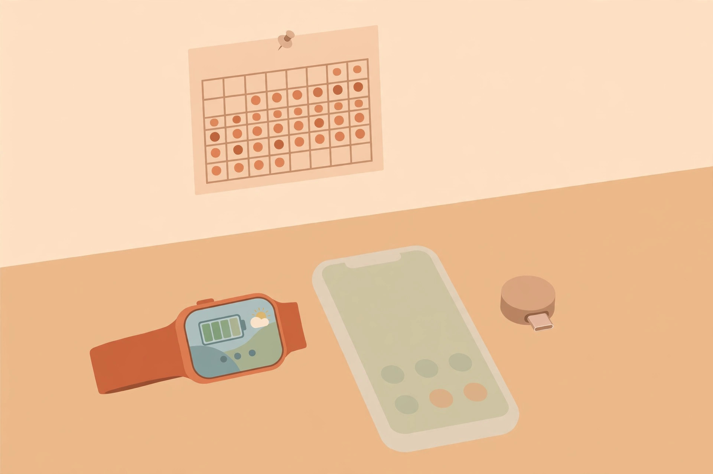

<!-- 본문 시작 -->
These days, charging a smartwatch every day feels normal — but a watch that only needs charging about once a month is back. Meet the Pebble Time 2. Pebble kicked off the smartwatch era with a crowdfunding sensation in 2012, then disappeared, and nine years later its founder has rebuilt it himself.

(Illustration) A square body, four buttons, and a color e-paper screen are its signatures. This is an illustration, not an actual product photo.

> 핵심 한 줄
>
> ### **If you are tired of charging your watch every day, look first at this watch, which evolved by taking things away.**

## What kind of watch is the Pebble Time 2?

It is the smartwatch announced on March 18, 2025, by Core Devices, the company founded by Pebble founder Eric Migicovsky. After Pebble was sold to Fitbit in 2016 and vanished, Migicovsky recovered the Pebble trademark and rebuilt the watch from the design of the 'Time 2', which never launched ten years ago. (Official blog and Engadget, confirmed 2026-11-09)

The screen is a 1.5-inch, 64-color e-paper display (200×228), always on by default. (Official specifications, confirmed 2026-11-09) It barely uses power and stays readable in sunlight. You control it with a touchscreen plus four physical buttons. The body is stainless steel 316 and polycarbonate, and it weighs 33 g without the strap. (Official specifications, confirmed 2026-11-09) Pebble itself describes this watch as "a second screen for your phone". Notifications, music, and weather checks are at its core.

## What makes it fun?

First, the battery. The manufacturer's estimate is 30 days on a single charge. (Official specifications, confirmed 2026-11-09) But do not take that number at face value. In March 2026 Pebble said the average at the time was 14 days, and in its July update the median was about 21 days. Engadget's reviewer used 82% of the battery in eight days of heavy use. "A month" is a target for careful use; in practice, two to three weeks is the realistic expectation.

Second, you can change almost anything about it. PebbleOS and the companion app are both open source, and most of the 10,000-plus watch faces and apps in the official app store are free. (Official website, confirmed 2026-11-09) The strap uses the standard 22 mm size.

Third, the buttons. One back button on the left and three buttons on the right handle most of the controls. You can press them even with gloves on. (Engadget review, 2026-08-25)

(Illustration) E-paper is actually easier to read in bright sunlight. One noted drawback is that the backlight only comes on when you flick your wrist firmly.

## What should you check before buying?

There is no GPS, no LTE, and no NFC payments. Fitness tracking stays at the basics — steps, sleep, and heart rate — and Pebble itself says this is not a serious sports watch, recommending Garmin instead. (Official product page, confirmed 2026-11-09) On iPhone you cannot reply to notifications, and there is no built-in stopwatch or timer app, so you need to find third-party apps. (Engadget review, 2026-08-25)

The software is still a work in progress. In its July 2026 update, Pebble itself disclosed three problems: inaccurate step and sleep records for some users, an accelerometer that stops intermittently, and a touchscreen that stops working or registers touches in the wrong place. No fix schedule had been set at the time. The same post disclosed 330 hardware replacements, 51 reports of cracked front glass, and 32 button problems.

It is rated water resistant to 30 m, but it is not a dive watch, and hot water should be avoided. It also contains about 10% nickel in its stainless steel, so people with a severe nickel allergy should be careful. (Official blog, 2026-03-24)

## How much does it cost, and can you buy it in Korea?

It costs 225 US dollars and is listed as in stock on the official store (repebble.com). (Confirmed 2026-11-09) Colors are black, red, grey, and blue. Shipping comes from a warehouse in Asia by international courier, and taxes and duties are prepaid (DDP), so there are no extra charges on delivery. US orders carry a tariff of about 10–12 dollars, but regions outside the US are not subject to the US tariff. (Official product page and blog, confirmed 2026-11-09)

There is no confirmed official seller in Korea, so in practice you buy it by ordering directly from the official store overseas. The Korean-won price, Korean-language support, and local after-sales service are unconfirmed. The warranty covers manufacturing defects for 30 days after delivery, and there are no refunds for a change of mind. (Official product page, confirmed 2026-11-09)

(Illustration) The charger is a tiny USB-C adapter about the length of a fingertip, so it is easy to carry. The same small size also makes it easy to lose, reviewers note.

## The editor's verdict

The Pebble Time 2 is not a "watch that does everything" — it is a watch that does less and lasts longer. It suits people who are tired of charging every night and mainly want notifications on their wrist. It does not suit people who track workouts closely or want to pay, call, and reply from their watch. Pebble itself tells those people to buy an Apple Watch or a Garmin. (Official product page, confirmed 2026-11-09)

| Item | Details |
|---|---|
| Display | 1.5-inch 64-color e-paper, 200×228, always on |
| Battery | Manufacturer estimate 30 days / median about 21 days as of July 2026 |
| Price | 225 US dollars (official store, confirmed 2026-11-09) |
| Water resistance | 30 m (no diving, no hot water) |
| Missing features | GPS, LTE, NFC payments |
| Buying in Korea | No confirmed official seller / order from the official store overseas |

## Related Posts

- [A Touchscreen on a USB Hub — Dockcase 7-in-1, What to Check Before Buying](https://aitechnotesen.wordpress.com/2026/11/08/a-touchscreen-on-a-usb-hub-dockcase-7in1-what-to-check-before-buying/) — A screen on a hub is a twist on an idea, in the same 'small gadget on your desk' family.
- [Fold It Shut and the Lens Closes — OBSBOT Meet Flip, What to Check Before Buying](https://aitechnotesen.wordpress.com/2026/11/08/fold-it-shut-and-the-lens-closes-obsbot-meet-flip-what-to-check-before-buying/) — A webcam whose lens closes when you fold it, a product whose physical solution is the fun part.
- [주간 AI 뉴스 모음｜매주 AI 소식, 한 번에 따라가기](https://blog.naver.com/3700708/224464427593) — A roundup of the week's AI news in one place.

## Sources

- [Pebble Time 2 official product page](https://repebble.com/watch)
- [Official blog: mass production update (2026-03-24)](https://repebble.com/blog/pebble-time-2-is-in-mass-production)
- [Official blog: mega update (July 2026)](https://repebble.com/blog/pebble-mega-update-july-2026)
- [Engadget review (2026-08-25)](https://www.engadget.com/2243490/pebble-time-2-review/)
- [Tom's Guide hands-on (2026-10-21)](https://www.tomsguide.com/wellness/smartwatches/i-just-went-hands-on-with-the-pebble-time-2-and-its-unlike-any-smartwatch-ive-ever-tested)
<!-- 본문 끝 -->
