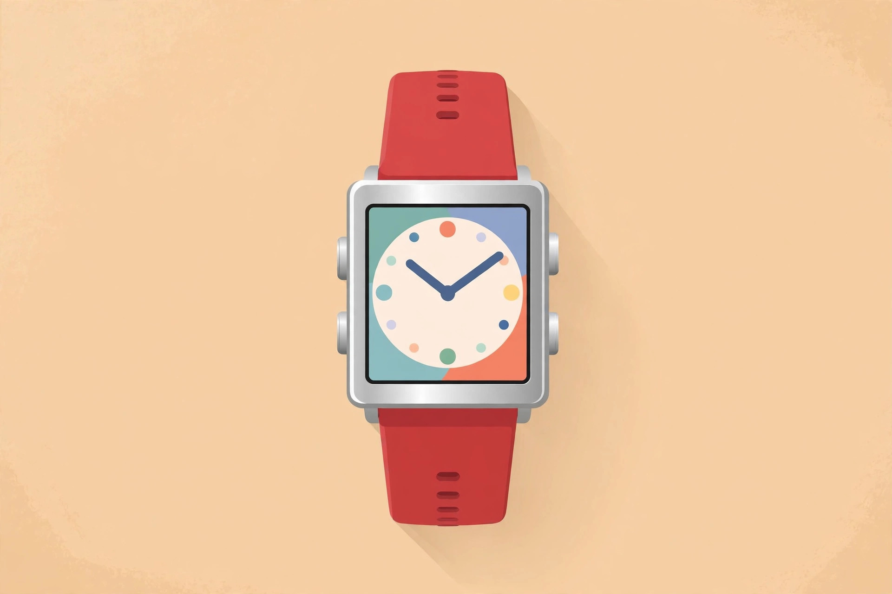
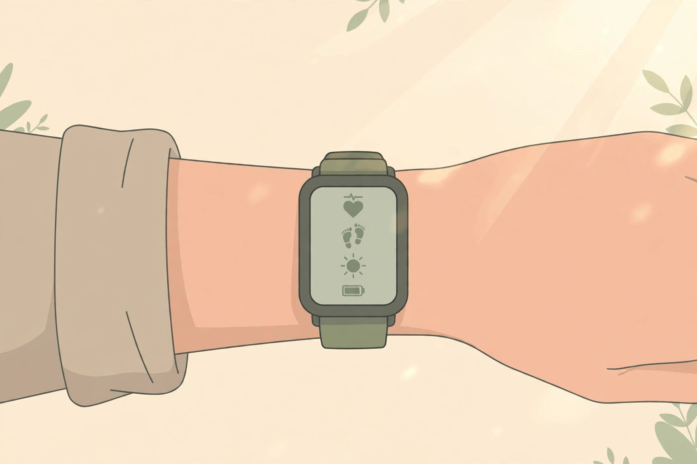
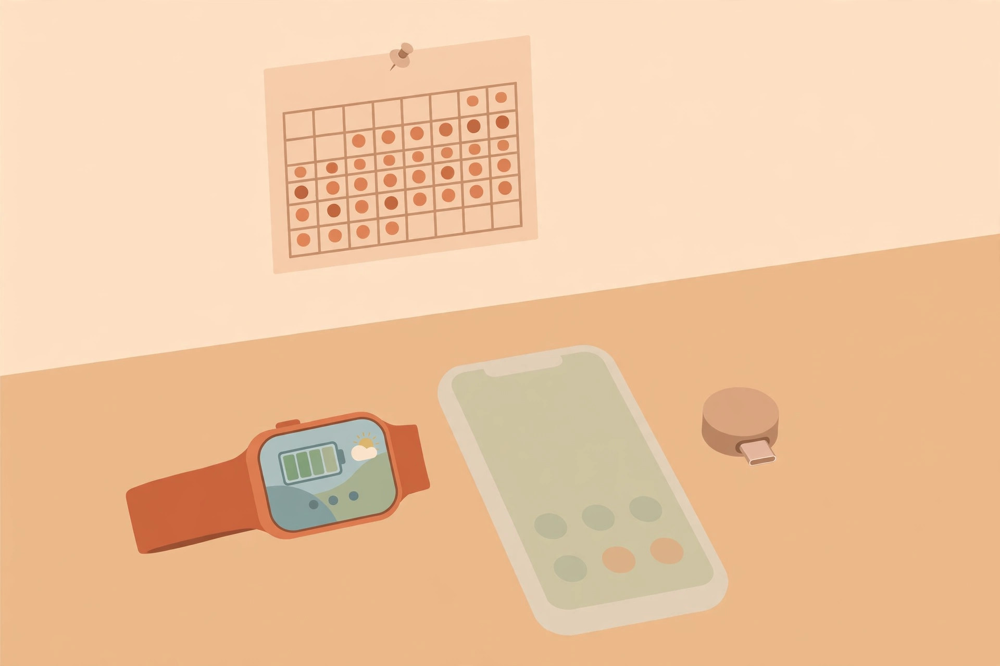

<!-- 본문 시작 -->
스마트워치를 매일 충전하는 게 당연해진 요즘, 한 달에 한 번만 충전하면 된다는 시계가 돌아왔습니다. 주인공은 페블 타임 2(Pebble Time 2)입니다. 2012년 크라우드펀딩 신화로 스마트워치 시대를 연 페블이 사라진 지 9년 만에, 창업자가 다시 만든 시계입니다.

(일러스트) 네 개의 물리 버튼은 장갑 낀 손으로도 누를 수 있어, 터치만 쓰는 시계와 조작감이 다릅니다.

> 핵심 한 줄
>
> ### **매일 충전하는 시계에 지쳤다면, 덜어내는 쪽으로 진화한 이 시계를 먼저 보세요.**

## 페블 타임 2는 어떤 시계인가요?

창업자 에릭 미기코프스키가 세운 코어 디바이시스(Core Devices)가 2025년 3월 18일 발표한 스마트워치입니다. 2016년 핏비트에 매각되며 사라졌던 페블 상표권을 되찾아, 10년 전 출시되지 못했던 '타임 2'의 설계를 바탕으로 다시 만들었습니다. (공식 블로그·Engadget, 2026-11-09 확인)

화면은 1.5인치 64색 전자종이(200×228), 상시 표시가 기본입니다. (공식 사양표, 2026-11-09 확인) 전원을 거의 쓰지 않고 햇빛 아래에서도 잘 보입니다. 조작은 터치스크린과 물리 버튼 네 개를 함께 씁니다. 본체는 스테인리스 316과 폴리카보네이트, 스트랩 제외 33g입니다. (공식 사양표, 2026-11-09 확인) 페블은 이 시계를 "휴대폰의 두 번째 화면"이라고 설명합니다. 알림·음악·날씨 확인이 중심입니다.

## 뭐가 재미있나요?

첫째, 배터리입니다. 제조사 추정치는 한 번 충전으로 30일입니다. (공식 사양표, 2026-11-09 확인) 다만 그대로 믿으면 안 됩니다. 2026년 3월 당시 평균은 14일, 7월 업데이트의 중앙값은 약 21일이었습니다. Engadget 리뷰어는 집중 사용 시 8일 만에 82%를 썼습니다. "한 달"은 아껴 쓸 때의 목표치, 실제로는 2~3주가 현실적입니다.

둘째, 마음대로 바꿀 수 있다는 점입니다. PebbleOS와 동반 앱이 모두 오픈소스이고, 앱스토어의 1만 개 넘는 워치페이스·앱은 대부분 무료입니다. (공식 홈페이지, 2026-11-09 확인) 시계줄은 22mm 표준 규격입니다.

셋째, 버튼입니다. 왼쪽 뒤로 가기 하나와 오른쪽 세 개 버튼으로 조작합니다. 장갑 낀 손으로도 누를 수 있습니다. (Engadget 리뷰, 2026-08-25)

(일러스트) 전자종이는 햇빛 아래에서 오히려 잘 보입니다. 다만 백라이트는 손목을 세게 흔들어야 켜진다는 지적이 있습니다.

## 사기 전에 확인할 점은?

GPS와 LTE, NFC 결제가 없습니다. 운동 기록은 걸음 수·수면·심박수 같은 기본 수준이고, 페블 스스로도 본격적인 운동 시계가 아니라며 가민을 권합니다. (공식 제품 페이지, 2026-11-09 확인) 아이폰 알림 답장이 안 되고, 스톱워치·타이머도 기본 앱이 없어 서드파티 앱을 찾아야 합니다. (Engadget 리뷰, 2026-08-25)

소프트웨어도 아직 진행 중입니다. 페블이 2026년 7월 직접 밝힌 문제는 걸음·수면 기록 부정확, 가속도계 간헐 중단, 터치스크린 오작동으로, 수정 일정은 미정이었습니다. 같은 글에서 교체 330건, 유리 파손 51건, 버튼 문제 32건도 공개했습니다.

방수 30m지만 다이빙용이 아니고 뜨거운 물은 피해야 하며, 니켈(약 10%) 포함 스테인리스라 알레르기가 심한 분은 주의해야 합니다. (공식 블로그, 2026-03-24)

## 가격과 국내 이용은?

가격은 225달러, 공식 스토어(repebble.com)에서 재고 있음으로 판매 중입니다. (2026-11-09 확인) 색상은 블랙·레드·그레이·블루입니다. 배송은 아시아 창고에서 국제 택배로 오고, 관세·세금은 선납(DDP)이라 추가 요금이 없습니다. 미국 주문에는 관세 약 10~12달러가 붙지만, 미국 외 지역은 미국 관세 대상이 아닙니다. (공식 제품 페이지·블로그, 2026-11-09 확인)

국내 정식 판매처는 확인되지 않아 사실상 해외 직구로 사는 형태입니다. 원화 정가·한국어 지원·국내 A/S는 미확인입니다. 보증은 제조 결함 수령 후 30일, 변심 환불은 없습니다. (공식 제품 페이지, 2026-11-09 확인)

(일러스트) 충전기는 손가락 한 마디만 한 USB-C 어댑터라 휴대가 쉽습니다. 다만 작아 잃어버리기 쉽다는 지적이 있습니다.

## 에디터의 판단

페블 타임 2는 "뭐든 다 되는 시계"가 아니라 "되는 일을 줄이고 오래 가는 시계"입니다. 매일 밤 충전이 번거로웠던 분, 알림 확인이 중심인 분께 어울립니다. 반대로 운동 기록을 꼼꼼히 챙기거나 시계로 결제·답장까지 하려는 분께는 맞지 않습니다. 페블 스스로도 그런 분께는 애플워치나 가민을 사라고 말합니다. (공식 제품 페이지, 2026-11-09 확인)

| 항목 | 내용 |
|---|---|
| 디스플레이 | 1.5인치 64색 전자종이, 200×228, 상시 표시 |
| 배터리 | 제조사 추정치 30일 / 2026년 7월 기준 중앙값 약 21일 |
| 가격 | 225달러 (2026-11-09 공식 스토어 확인) |
| 방수 | 30m (다이빙·뜨거운 물 불가) |
| 없는 기능 | GPS·LTE·NFC 결제 |
| 국내 이용 | 국내 정식 판매 미확인 / 공식 스토어 해외 직구 |

## 함께 보면 좋은 글

- [허브에 터치스크린을 달았다 — Dockcase 7-in-1, 사기 전에 확인할 조건](https://blog.naver.com/3700708/224468837400) — 허브에 화면을 단 발상의 전환, 같은 '책상 위 작은 기기' 계열입니다.
- [접으면 렌즈가 닫힌다 — OBSBOT Meet Flip, 사기 전에 확인할 조건](https://blog.naver.com/3700708/224468837113) — 접으면 렌즈가 닫히는 웹캠, 물리적인 해법이 재미있는 제품입니다.
- [주간 AI 뉴스 모음｜매주 AI 소식, 한 번에 따라가기](https://blog.naver.com/3700708/224464427593) — 한 주간의 AI 소식을 한 번에 정리한 모음 글입니다.

## 출처

- [Pebble Time 2 공식 제품 페이지](https://repebble.com/watch)
- [공식 블로그: 양산 소식 (2026-03-24)](https://repebble.com/blog/pebble-time-2-is-in-mass-production)
- [공식 블로그: 메가 업데이트 (2026-07)](https://repebble.com/blog/pebble-mega-update-july-2026)
- [Engadget 리뷰 (2026-08-25)](https://www.engadget.com/2243490/pebble-time-2-review/)
- [Tom's Guide 핸즈온 (2026-10-21)](https://www.tomsguide.com/wellness/smartwatches/i-just-went-hands-on-with-the-pebble-time-2-and-its-unlike-any-smartwatch-ive-ever-tested)
<!-- 본문 끝 -->
