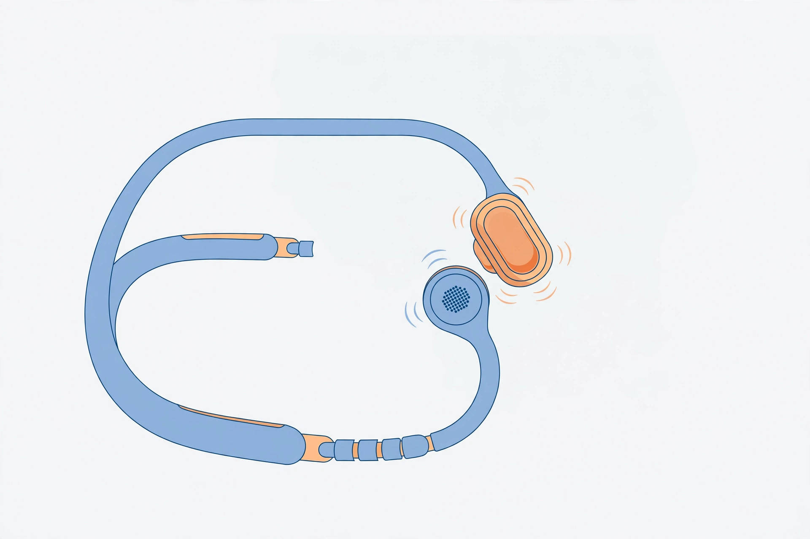

<!-- 본문 시작 -->
On a morning run, not hearing a car coming up behind you is dangerous. But earbuds that seal your ears block out the world along with the music. The **Shokz OpenRun Pro 2** is a bone conduction headphone that lets you hear sound without blocking your ears. The summary below is based on official materials and independent reviews; it is not a hands-on review.

The 12-hour playtime is the manufacturer's rated figure. Actual playtime varies with volume and conditions. (Illustration)

## What It Is

The OpenRun Pro 2 is Shokz's flagship open-ear sports headphone, launched in autumn 2024. Its DualPitch design pairs a bone conduction driver for mids and highs with an air conduction driver for bass (official product page, checked 2026-11-10). Because your ears stay open, you can still hear traffic and your surroundings while you run.

## Three Things That Stand Out

First, the bass is finally there. Weak bass has long been the Achilles' heel of bone conduction headphones. The Pro 2 adds a separate air conduction driver to fill in the low end. In a hands-on review dated 2026-11-02, the French trail-running magazine Trail France said the Pro 2 fixes the two weaknesses of its predecessor: weak bass and a tight clamping fit.

Second, battery life is generous. The official spec promises up to 12 hours of playtime, and a 5-minute charge gives 2.5 hours of listening (official product page, checked 2026-11-10). Charging is USB-C, so you can use a cable you already own.

Third, comfort and connectivity. It weighs 30.3 g, and according to the manufacturer the nickel-titanium alloy band clamps 16% less than the previous generation (based on Shokz Lab tests). Bluetooth 5.3 with multipoint lets you stay connected to a phone and a laptop at the same time, and the app offers four EQ presets plus two custom EQ slots.

A separate air conduction driver handles the bass. That is a different structure from the previous model, which relied on bone conduction alone. (Illustration)

> Key takeaway
>
> ### **Ears open, bass included. But it is weaker against water.**

## Shortcomings and Things to Check

The first thing to check is the water resistance rating. The Pro 2 is rated IP55: fine against rain and sweat, but not for swimming, showering, or saunas (official FAQ, checked 2026-11-10). That is a step down from the original OpenRun, which was IP67.

Second, the music does not pause when you take them off. A MensXP review (2026-10-29) notes the lack of auto-pause. And because the design is open-ear, sound can leak in quiet places. MensXP found that at 70–80% volume, people nearby could barely make out what was playing, but in a library or a quiet office it is safer to keep the volume down.

Finally, sizing. The band comes in two lengths, Standard (S820) and Mini (S821), at the same price. If the size does not match your head, the fit will feel different, so check the size guide before buying. There is also no noise cancelling, so music can get buried in noisy places like the subway.

IP55 covers rain and sweat. It is not for swimming, showering, or saunas. (Illustration)

## Price and Availability in Korea

The US official store price is $179.95 (checked 2026-11-06). In Korea, the listed regular price is 249,000 KRW, with online sellers around the low 240,000 KRW range (241,530 KRW in an LFmall price roundup dated 2026-11-08). Price comparison sites go as low as 166,004 KRW on Danawa (as of 2026-11-07), and direct imports on Coupang go down to the 130,000 KRW range. But warranty terms differ by channel: Coupang Rocket direct import includes a one-year in-house warranty, while AliExpress direct imports have uncertain warranty coverage, with no official Korean after-sales service (comparison dated 2026-10-20).

The sibling model, the OpenRun Air 2, launched on September 16, 2026, at 19,880 yen in Japan, with IP67 water resistance, 10 hours of playtime, and a weight of 26.4 g. It is cheaper than the Pro 2 and better protected against water, but it has no air conduction bass driver and two hours less playtime.

## The Editor's Call

This fits people who need to hear their surroundings: morning runners, cyclists, and commuters on foot. The combination of open ears and real bass is the reason this product exists. It can also be a good fit if long earbud sessions leave your ears feeling stuffy.

But if you are buying now, compare it with the Air 2 before paying for the Pro 2. If water resistance and price matter most, pick the Air 2; if bass and playtime matter most, pick the Pro 2. Neither is for swimming, and if you mostly listen in quiet indoor spaces, a regular earbud may suit you better.

## Key Facts

| Item | Details |
|---|---|
| Product | Shokz OpenRun Pro 2 (S820 Standard / S821 Mini) |
| Design | Bone conduction + air conduction (DualPitch), open-ear |
| Playtime | Up to 12 hours (manufacturer rating), 2.5 hours from a 5-minute charge |
| Water resistance | IP55 (rain and sweat OK; no swimming, showering, or sauna) |
| Weight & connectivity | 30.3 g, Bluetooth 5.3, USB-C charging, multipoint |
| Price | US $179.95 / Korea low-240,000 KRW range online (checked 2026-11-10) |
| Availability in Korea | Sold through Korean online sellers; check warranty terms separately for direct imports |

## Recommended Reads

- [The smartwatch everyone thought was dead is back — Pebble Time 2, what to check before buying](https://blog.naver.com/3700708/224469793671) — A guide to the conditions worth checking before buying a revived smartwatch.
- [A 171-inch screen inside glasses — XREAL One Pro, what to check before buying](https://blog.naver.com/3700708/224469793363) — Another way wearables can expand everyday life.
- [Weekly AI news roundup | Catch up on AI news once a week](https://blog.naver.com/3700708/224464427593) — A weekly roundup to catch up on AI news in one place.

## Sources

- [Shokz OpenRun Pro 2 official product page](https://shokz.com.au/products/openrun-pro2)
- [dupple — Shokz OpenRun Pro 2 Review 2026](https://dupple.com/blog/shokz-openrun-pro-2-review-2026)
- [Marathon Journal — Shokz OpenRun Pro 2 Review](https://marathonjournal.com/shokz-openrun-pro-2-review/)
- [MensXP — Shokz OpenRun Pro 2 Review](https://www.mensxp.com/technology/portable-media/186554-shokz-openrun-pro-2-india-review.html)
- [Trail France — Shokz OpenRun Pro 2 Test](https://www.trail-france.fr/blog/test-shokz-openrun-pro-2-avis-trail-conduction-osseuse)
- [race-dogu — Best Running Earphones, Fall 2026](https://race-dogu.com/en/guide/running-earphones-osusume-2026/)
- [earphonepick — OpenRun Pro 2 Standard vs Mini comparison](https://earphonepick.com/%ec%83%a5%ec%a6%88-%ec%98%a4%ed%94%88%eb%9f%b0-%ed%94%84%eb%a1%9c-2-%ec%9d%bc%eb%b0%98%ed%98%95%c2%b7%eb%af%b8%eb%8b%88-%eb%b9%84%ea%b5%90-%ea%b0%99%ec%9d%80-236550%ec%9b%90%ec%9d%b4%eb%a9%b4-s820/)
- [blogchart — OpenRun Pro 2 direct-import warranty comparison](https://www.blogchart.co.kr/trend/%EC%83%A5%EC%A6%88-%EC%98%A4%ED%94%88%EB%9F%B0-%ED%94%84%EB%A1%9C2-%EC%A7%81%EA%B5%AC)
<!-- 본문 끝 -->
