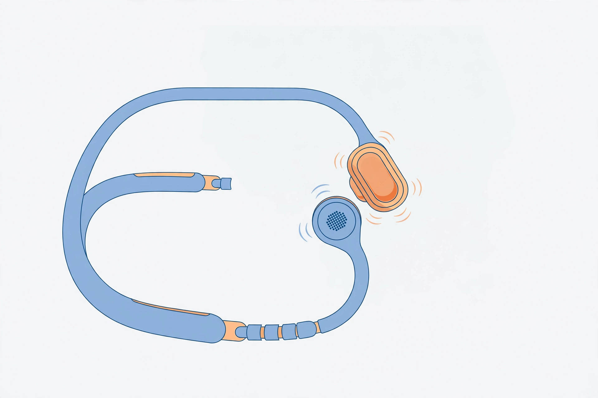

<!-- 본문 시작 -->
아침 러닝 코스에서 뒤에서 오는 차 소리를 못 들으면 위험합니다. 그런데 귀를 막는 이어폰을 끼면 음악은 잘 들려도 주변 소리는 사라집니다. **Shokz OpenRun Pro 2**는 귀를 막지 않고 소리를 듣는 골전도 이어폰입니다. 아래 내용은 공식 자료와 독립 리뷰를 바탕으로 정리한 것으로, 직접 사용한 후기가 아닙니다.

12시간 재생은 제조사 기준 수치입니다. 실제 사용 시간은 볼륨과 환경에 따라 달라집니다. (일러스트)

## 제품의 정체

OpenRun Pro 2는 Shokz가 2024년 가을 출시한 플래그십 오픈이어 스포츠 헤드폰입니다. 골전도 드라이버가 중·고음을, 공기전도 드라이버가 저음을 맡는 DualPitch 구조가 특징입니다(공식 제품 페이지, 2026-11-10 확인). 귀를 막지 않으니 달리는 동안 차 소리와 주변 소리를 들을 수 있습니다.

## 눈에 띄는 특징 세 가지

첫째, 저음이 붙었습니다. 골전도 이어폰의 고질적 약점은 저음 부족이었습니다. Pro 2는 공기전도 드라이버를 따로 달아 저음을 보강했습니다. 프랑스 트레일 러닝 매체 Trail France의 실사용 리뷰(2026-11-02)는 전작의 두 가지 약점인 저음 부족과 조이는 압박감이 개선됐다고 평가했습니다.

둘째, 재생 시간이 넉넉합니다. 공식 사양 기준 최대 12시간, 5분 충전으로 2.5시간을 들을 수 있습니다(공식 제품 페이지, 2026-11-10 확인). 충전은 USB-C라 집에 있는 케이블을 그대로 쓸 수 있습니다.

셋째, 착용감과 연결성입니다. 무게 30.3g, 니켈-티타늄 합금 밴드는 전작보다 조이는 힘이 16% 줄었다고 제조사는 설명합니다(Shokz Lab 실험 기준). 블루투스 5.3에 멀티포인트를 지원해 폰과 노트북 두 대에 동시에 연결할 수 있고, 앱에서 EQ 4종과 커스텀 EQ 2개를 고를 수 있습니다.

저음은 공기전도 드라이버가 따로 맡습니다. 골전도만 쓰던 전작과 구조가 다릅니다. (일러스트)

> 핵심 한 줄
>
> ### **귀는 열어두고, 저음은 포기하지 않는다. 단, 물에는 약해졌습니다.**

## 아쉬운 점과 확인할 점

가장 먼저 짚을 점은 방수 등급입니다. Pro 2는 IP55로, 빗방울과 땀에는 강하지만 수영·샤워·사우나에는 쓸 수 없습니다(공식 FAQ, 2026-11-10 확인). 전작 OpenRun이 IP67이었던 것을 생각하면 한 단계 내려간 셈입니다.

둘째, 벗으면 음악이 멈추지 않습니다. MensXP 리뷰(2026-10-29)는 자동 일시정지 기능이 없다고 지적했습니다. 또 오픈이어 구조라 조용한 공간에서는 소리가 샐 수 있습니다. MensXP는 70~80% 볼륨에서는 옆 사람이 알아듣기 어렵다고 평가했지만, 도서관이나 조용한 사무실에서는 볼륨을 낮춰 쓰는 편이 안전합니다.

마지막으로 사이즈입니다. 스탠더드(S820)와 미니(S821) 두 가지 밴드 길이로 나오는데 가격은 같습니다. 머리 크기에 맞지 않으면 착용감이 달라지니 구매 전에 사이즈 가이드를 확인하세요. 노이즈캔슬링이 없어 지하철처럼 시끄러운 곳에서는 음악이 묻힐 수 있습니다.

IP55는 빗방울과 땀까지입니다. 수영·샤워·사우나에는 쓸 수 없습니다. (일러스트)

## 가격과 국내 이용

미국 공식 스토어 가격은 179.95달러입니다(2026-11-06 확인). 국내에서는 정가 249,000원 표시와 함께 온라인 판매가 24만 원대 초반에 형성돼 있습니다(2026-11-08 LFmall 집계 241,530원). 가격 비교 사이트에서는 다나와 최저가 166,004원(2026-11-07 기준)까지 내려가고, 쿠팡 직구는 13만 원대까지 있습니다. 다만 직구는 A/S 조건이 다릅니다. 쿠팡 로켓직구는 1년 자체 보증을 제공하지만, 알리익스프레스 직구는 국내 정식 A/S는 물론 판매처 자체 보증도 불확실하다는 비교가 있습니다(2026-10-20 확인).

동생 모델 OpenRun Air 2는 2026년 9월 16일 출시됐고, 일본 기준 19,880엔에 IP67 방수, 10시간 재생, 26.4g입니다. Pro 2보다 저렴하고 방수 등급도 높지만, 저음용 공기전도 드라이버가 없고 재생 시간도 2시간 짧습니다.

## 에디터의 판단

아침 러닝·자전거·출퇴근길 걷기처럼 주변 소리를 들어야 하는 분께 어울립니다. 저음을 포기하지 않으면서 귀를 열어두는 조합이 이 제품의 존재 이유입니다. 귀가 답답했던 분께도 오픈이어 구조가 장점이 될 수 있습니다.

다만 새로 산다면 Pro 2를 바로 결제하기보다 Air 2와 먼저 비교해 보길 권합니다. 방수와 가격이 우선이면 Air 2, 저음과 재생 시간이 우선이면 Pro 2입니다. 수영이 목적이라면 둘 다 아니고, 조용한 실내에서 주로 쓴다면 일반 이어폰이 나을 수 있습니다.

## 핵심 정보

| 항목 | 내용 |
|---|---|
| 제품명 | Shokz OpenRun Pro 2 (S820 일반형 / S821 미니) |
| 방식 | 골전도 + 공기전도(DualPitch), 오픈이어 |
| 재생 시간 | 최대 12시간 (제조사 기준), 5분 충전 시 2.5시간 |
| 방수 | IP55 (빗방울·땀 가능, 수영·샤워·사우나 불가) |
| 무게·연결 | 30.3g, 블루투스 5.3, USB-C 충전, 멀티포인트 |
| 가격 | 미국 179.95달러 / 국내 판매가 24만 원대 초반 (2026-11-10 확인) |
| 국내 판매 | 국내 온라인 판매 중, 직구 시 A/S 조건 별도 확인 필요 |

## 함께 보면 좋은 글

- [죽은 줄 알았던 스마트워치가 돌아왔다 — 페블 타임 2, 사기 전에 확인할 조건](https://blog.naver.com/3700708/224469793671) — 부활한 스마트워치를 사기 전에 확인할 조건을 정리한 글입니다.
- [안경에 171인치 화면을 담았다 — XREAL One Pro, 사기 전에 확인할 조건](https://blog.naver.com/3700708/224469793363) — 몸에 걸치는 기기로 일상을 넓히는 또 다른 방법을 소개합니다.
- [주간 AI 뉴스 모음｜매주 AI 소식, 한 번에 따라가기](https://blog.naver.com/3700708/224464427593) — 매주 AI 소식을 한 번에 따라갈 수 있는 모음 글입니다.

## 출처

- [Shokz OpenRun Pro 2 공식 제품 페이지](https://shokz.com.au/products/openrun-pro2)
- [dupple — Shokz OpenRun Pro 2 리뷰 2026](https://dupple.com/blog/shokz-openrun-pro-2-review-2026)
- [Marathon Journal — Shokz OpenRun Pro 2 리뷰](https://marathonjournal.com/shokz-openrun-pro-2-review/)
- [MensXP — Shokz OpenRun Pro 2 리뷰](https://www.mensxp.com/technology/portable-media/186554-shokz-openrun-pro-2-india-review.html)
- [Trail France — Shokz OpenRun Pro 2 테스트](https://www.trail-france.fr/blog/test-shokz-openrun-pro-2-avis-trail-conduction-osseuse)
- [race-dogu — 2026년 가을 러닝 이어폰 비교](https://race-dogu.com/en/guide/running-earphones-osusume-2026/)
- [earphonepick — 오픈런 프로 2 일반형·미니 비교](https://earphonepick.com/%ec%83%a5%ec%a6%88-%ec%98%a4%ed%94%88%eb%9f%b0-%ed%94%84%eb%a1%9c-2-%ec%9d%bc%eb%b0%98%ed%98%95%c2%b7%eb%af%b8%eb%8b%88-%eb%b9%84%ea%b5%90-%ea%b0%99%ec%9d%80-236550%ec%9b%90%ec%9d%b4%eb%a9%b4-s820/)
- [blogchart — 오픈런 프로 2 직구 A/S 비교](https://www.blogchart.co.kr/trend/%EC%83%A5%EC%A6%88-%EC%98%A4%ED%94%88%EB%9F%B0-%ED%94%84%EB%A1%9C2-%EC%A7%81%EA%B5%AC)
<!-- 본문 끝 -->
