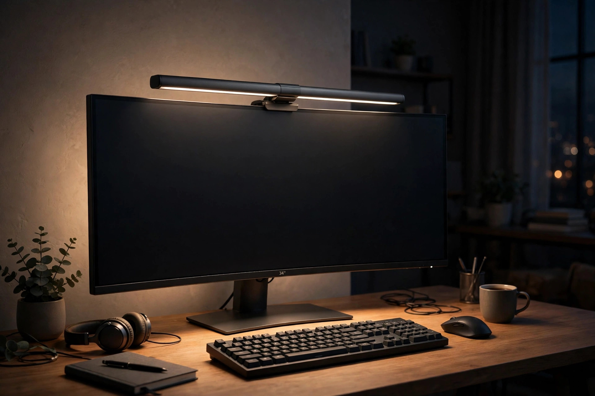
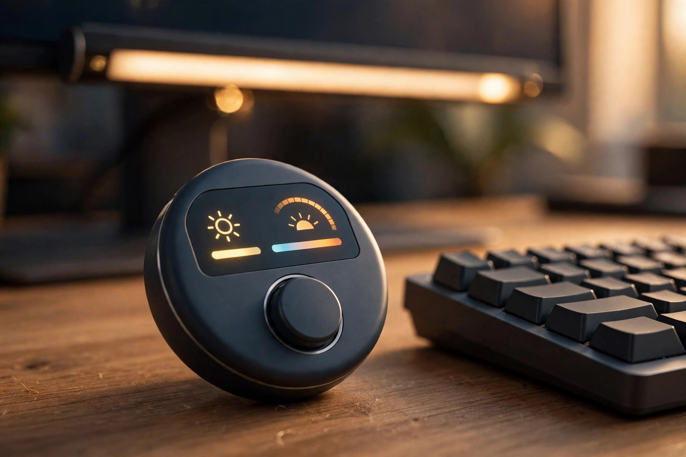
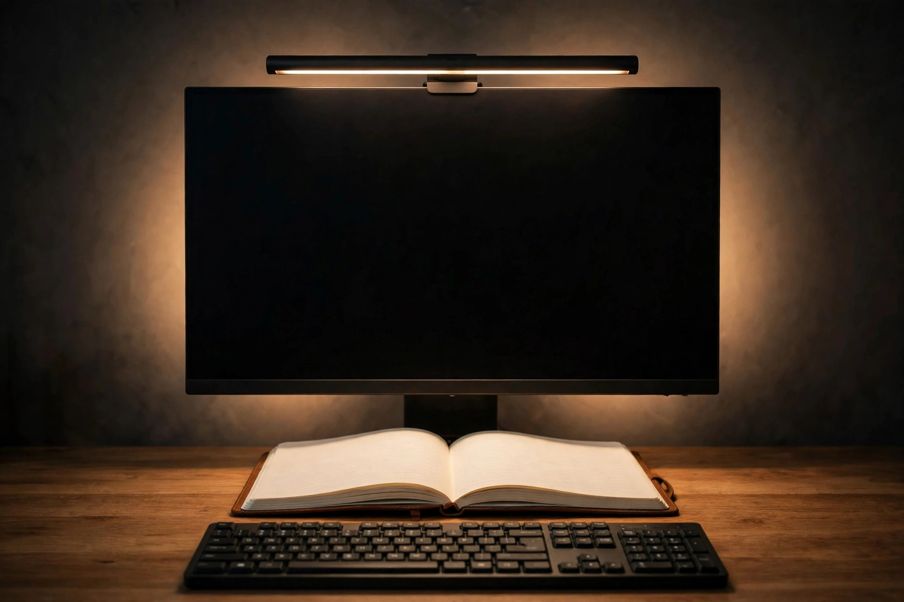

<!-- 본문 시작 -->
It is 11 p.m. You have turned off the room light and are working with only the monitor on. The screen is bright while everything around it is dark, so your eyes keep adjusting back and forth. Turn on a desk lamp and its light reflects off the monitor, which is distracting instead.

BenQ's ScreenBar Halo 2 is a monitor light aimed squarely at that problem. It is a bar-shaped light that sits right on top of the monitor, sending light only toward the desk and never onto the screen. It is the second-generation model, launched in Korea in June 2025. This post is based on official materials and reviews, not on hands-on use.

(Illustration) It lights the desk, not the screen.

> 핵심 한 줄
>
> ### **It lights only the desk, never the screen**

## What kind of light is it?

The follow-up to the monitor light BenQ first introduced in 2017, the ScreenBar series has sold more than one million units worldwide, according to BenQ's official page (confirmed 2026-11-10). It clips onto the top of the monitor, so it takes up no desk space like a desk lamp does. The lamp is 50 cm long, weighs 0.8 kg, and comes in a single dark grey color (official specifications, confirmed 2026-11-10).

## What makes it fun?

First, it lights both the front and the back. The front light uses an asymmetric optical design that sends 94.9% of its light toward the desk, so almost none of it reaches the screen (manufacturer statement, IT Donga report, 2025-05-22). Center brightness is 1,100 lux, and it covers an 85×50 cm area at 500 lux. One button press adjusts it automatically to 500 lux (official page and IT Donga report, confirmed 2026-11-10). The three-zone backlight on the rear glows softly against the wall, keeping the contrast between the screen and its surroundings at or below the ANSI-recommended 1:3, according to the manufacturer (official page, confirmed 2026-11-10).

Second, it turns on by itself when you sit down. An ultrasonic sensor detects you and switches the light on when you sit at the desk, and off when you leave (IT Donga report, 2025-05-22).

Third, the wireless controller. A small dial on the desk adjusts brightness and color temperature, and the values show as numbers on a display tilted at 15 degrees (official page, confirmed 2026-11-10). You can adjust the front and back lights separately, and the manufacturer says a single charge lasts up to three months (official page, confirmed 2026-11-10). Color temperature runs from 2,700K to 6,500K, with a color rendering index of Ra 95 or higher and a color fidelity index of Rf 96 or higher (official specifications, confirmed 2026-11-10).

(Illustration) Turn the dial and the values show as numbers.

## What to check before buying?

First, the price. The Korean launch price was 279,000 won (launched June 9, 2025, IT Donga report). The US list price was $199, and the Amazon price was $179.99 (MacSources, confirmed 2026-04-09). The current Korean street price varies by store, so it could not be confirmed as of 2026-11-10.

Second, on front light alone it is not very different from the cheaper model. An analysis comparing BenQ's official figures found the Halo 2's front light identical to the ScreenBar Pro ($139 in the US) (deskanddaylight, confirmed 2026-10-11). The extra money for the Halo 2 is effectively paying for the rear light, the wireless controller, and the motion sensor.

Third, reviewers note that the rear light effect is hard to notice in a bright room (MacSources, 2026-04-09). Check compatibility too. Officially it fits monitors 0.43–6 cm thick, and curved monitors with a curvature of 1000R–1800R (official specifications, confirmed 2026-11-10). It runs on USB-C 5V, up to 3A, with a maximum draw of 15W (official specifications, confirmed 2026-11-10). The Korean warranty period and after-sales terms could not be confirmed (unconfirmed).

(Illustration) It covers 85×50 cm at 500 lux.

## Price and buying in Korea

It launched in Korea on June 9, 2025 (IT Donga, 2025-05-16 report). It is sold through outlets including BenQ Korea's Naver Brand Store (IT Donga, 2025-04-18 report).

## The editor's verdict

The ScreenBar Halo 2 is a light for people who want the desk lamp off the desk but whose eyes get tired at night. It suits night workers, gamers, and students who spend long hours in front of a monitor after dark. If you mostly work in a bright room during the day, or you are already happy with a desk lamp, there is no need to buy one. If you do buy, first decide whether the rear ambient light and auto-on are worth the price difference — otherwise, compare it with the ScreenBar Pro.

| Item | Details |
|---|---|
| Product | BenQ ScreenBar Halo 2 (CR23_C) |
| Color temperature | 2,700–6,500K, Ra 95↑ · Rf 96↑ |
| Brightness | 1,100 lux at center · 85×50 cm (at 500 lux) |
| Power | USB-C 5V, up to 3A, max 15W |
| Compatibility | 0.43–6 cm thick, curved 1000R–1800R |
| Korean launch price | 279,000 won (2025-06-09) |
| Current street price | Unconfirmed |

## Related Posts

- [The Smartwatch Everyone Thought Was Dead Is Back — Pebble Time 2, What to Check Before Buying](https://blog.naver.com/3700708/224469793671) — An e-paper watch that goes a month without charging: a different answer to making things last.
- [A 171-Inch Screen in Your Glasses — XREAL One Pro, What to Check Before Buying](https://blog.naver.com/3700708/224469793363) — Another way to clear desk space: put the screen in your glasses instead of on your monitor.
- [주간 AI 뉴스 모음｜매주 AI 소식, 한 번에 따라가기](https://blog.naver.com/3700708/224464427593) — A roundup of the week's AI news in one place.

## Sources

- [BenQ ScreenBar Halo 2 official product page](https://www.benq.com/en-au/lighting/monitor-light/screenbar-halo-2.html)
- [BenQ Australia press release: ScreenBar Halo 2 launch (2025-05-16)](https://www.BenQ.com/en-au/news/products/screenbar-halo-2-press-release.html)
- [IT Donga report: BenQ launches ScreenBar Halo 2 in Korea (2025-05-16) — republished by Danawa DPG](http://dpg.danawa.com/news/view?boardSeq=60&listSeq=5816375)
- [MacSources review (2026-04-09)](https://macsources.com/benq-screenbar-halo-2-review/)
- [deskanddaylight: Halo 2 vs ScreenBar Pro comparison (confirmed 2026-10-11)](https://deskanddaylight.com/lighting/benq-screenbar-halo-2-vs-screenbar-pro)
- [ScreenBar Halo 2 user guide (model CR23_C)](https://manuals.plus/m/6be00ecc4f6ce2119db774b244911b525fec76ab927390d228b0cfad695d8c9f)
<!-- 본문 끝 -->
