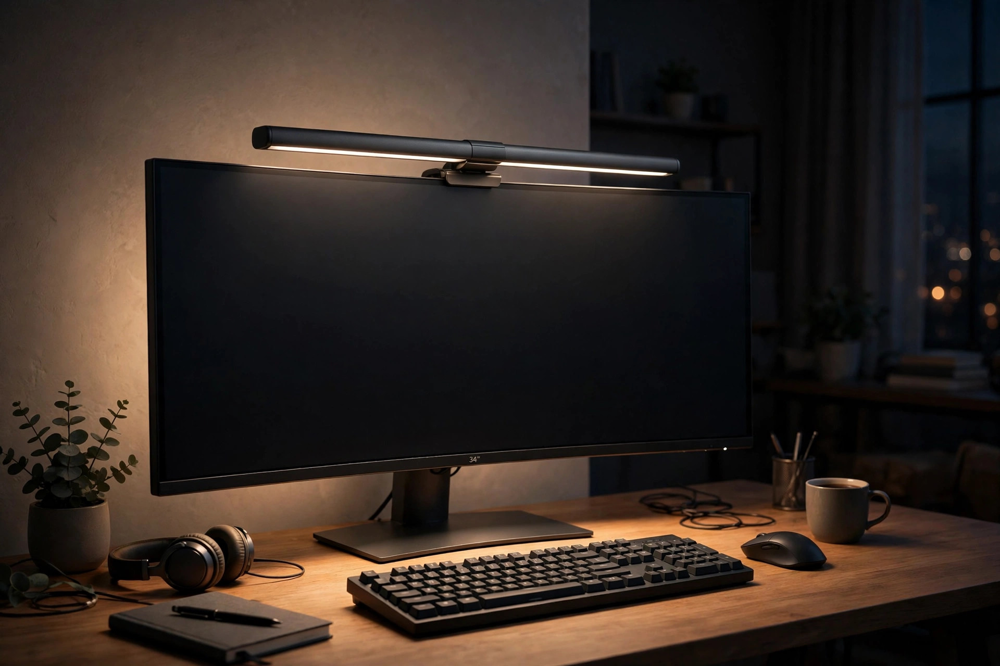
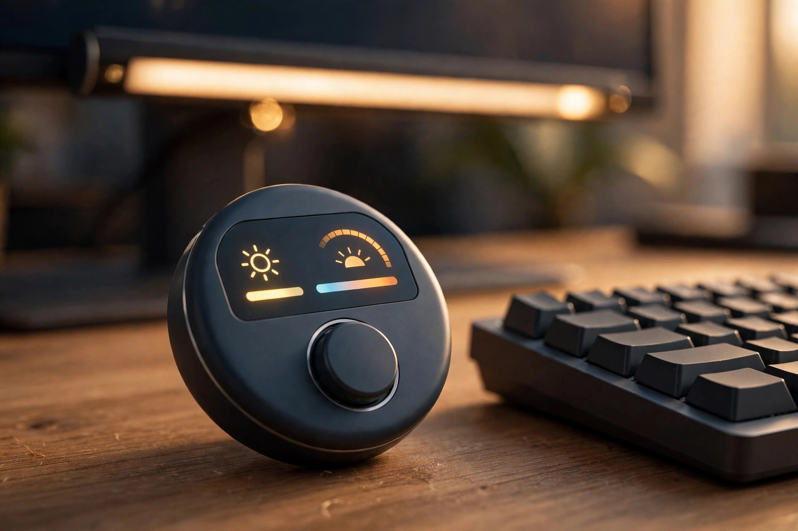

<!-- 본문 시작 -->
밤 11시, 방 불을 끄고 모니터만 켜둔 채로 일해본 적 있으신가요? 화면은 환한데 주변은 깜깜해 눈이 쉴 새 없이 조절을 반복합니다. 스탠드를 켜면 불빛이 모니터에 반사돼 거슬릴 때가 많습니다.

벤큐(BenQ)의 '스크린바 헤일로 2(ScreenBar Halo 2)'는 이 불편을 겨냥한 모니터 조명입니다. 모니터 위에 얹는 막대형 조명으로, 빛은 책상 쪽으로만 보내고 화면에는 닿지 않게 설계됐습니다. 2025년 6월 국내에 출시된 2세대 모델입니다. 자료를 바탕으로 정리한 글입니다.

(일러스트) 화면이 아닌 책상만 밝힙니다.

> 핵심 한 줄
>
> ### **책상만 밝히고 화면은 건드리지 않는다**

## 어떤 조명인가요?

2017년 첫 모니터 조명의 후속작으로, 시리즈는 전 세계에서 100만 대 이상 팔렸습니다(공식 페이지, 2026-11-10 확인). 클립으로 모니터 위에 고정해 책상 자리를 차지하지 않습니다. 램프 길이 50cm, 무게 0.8kg, 다크 그레이 단일 색상입니다(공식 사양표, 2026-11-10 확인).

## 뭐가 재미있나요?

첫째, 앞뒤를 함께 밝힙니다. 전면 조명은 비대칭 광학 설계로 빛의 94.9%를 책상 쪽으로 보냅니다(제조사 발표, IT동아 2025-05-22 보도). 중앙부 밝기는 1,100룩스, 500룩스 기준 면적은 85×50cm이고, 버튼 한 번으로 500룩스에 맞추는 자동 조절도 됩니다(공식 페이지·IT동아 보도, 2026-11-10 확인). 뒤쪽 3구역 백라이트는 벽을 은은하게 밝혀 화면과 주변의 명암 대비를 ANSI 권장 1:3 이하로 맞춘다고 합니다(공식 페이지, 2026-11-10 확인).

둘째, 앞에 앉으면 알아서 켜집니다. 초음파 센서가 사용자를 감지해 자리에 앉으면 켜고, 비우면 끕니다(IT동아 2025-05-22 보도).

셋째, 무선 컨트롤러입니다. 책상 위 작은 다이얼로 밝기와 색온도를 조절하고, 15도 기울어진 디스플레이에 값이 숫자로 표시됩니다(공식 페이지, 2026-11-10 확인). 앞뒤 밝기를 따로 조절할 수 있고, 1회 충전으로 최대 3개월 쓸 수 있다고 제조사는 밝힙니다(공식 페이지, 2026-11-10 확인). 색온도 2,700~6,500K, 연색성 Ra 95↑·색 충실도 Rf 96↑입니다(공식 사양표, 2026-11-10 확인).

(일러스트) 다이얼을 돌리면 값이 표시됩니다.

## 확인할 점은?

가장 먼저 가격입니다. 국내 출시가는 27만 9,000원입니다(2025년 6월 9일 출시, IT동아 보도). 미국 정가는 199달러, 아마존 판매가는 179.99달러였습니다(MacSources, 2026-04-09 확인). 현재 국내 판매가는 쇼핑몰마다 달라 2026-11-10 기준으로 확정하지 못했습니다.

둘째, 전면 빛만 놓고 보면 하위 모델과 차이가 크지 않습니다. 벤큐 공식 수치를 비교한 분석에 따르면, 헤일로 2의 전면 조명은 스크린바 프로(미국 139달러)와 동일합니다(deskanddaylight, 2026-10-11 확인). 헤일로 2의 추가 금액은 사실상 후면 조명·무선 컨트롤러·모션 센서 값입니다.

셋째, 밝은 방에서는 후면 조명 효과가 잘 안 느껴진다는 지적이 있습니다(MacSources, 2026-04-09). 공식 호환은 모니터 두께 0.43~6cm, 곡면 모니터는 곡률 1000R~1800R입니다(공식 사양표, 2026-11-10 확인). 전원은 USB-C 5V·최대 3A, 최대 15W입니다(공식 사양표, 2026-11-10 확인). 국내 보증 기간과 A/S 조건은 확인하지 못했습니다(미확인).

(일러스트) 500룩스 기준 면적 85×50cm입니다.

## 가격과 국내 이용

국내 출시일은 2025년 6월 9일입니다(IT동아, 2025-05-16 보도). 벤큐코리아 네이버 브랜드 스토어 등에서 팝니다(IT동아 2025-04-18 보도).

## 에디터의 판단

스크린바 헤일로 2는 "책상 스탠드를 치우고 싶은데 밤에 눈이 피로한 사람"을 위한 조명입니다. 밤에 장시간 모니터를 보는 야간 작업자·게이머·수험생에게 가장 어울립니다. 밝은 방에서 낮에만 쓰거나 이미 스탠드에 만족한다면 굳이 살 필요가 없습니다. 후면 조명과 자동 켜짐이 값어치를 하는지 따져보고, 아니라면 프로와 비교해보는 게 현명합니다.

| 항목 | 내용 |
|---|---|
| 제품명 | BenQ ScreenBar Halo 2 (CR23_C) |
| 색온도 | 2,700~6,500K, Ra 95↑·Rf 96↑ |
| 밝기 | 중앙 1,100룩스·85×50cm(500룩스) |
| 전원 | USB-C 5V·최대 3A, 최대 15W |
| 호환 | 두께 0.43~6cm, 곡면 1000R~1800R |
| 국내 출시가 | 279,000원 (2025-06-09) |
| 현재 판매가 | 미확인 |

## 함께 보면 좋은 글

- [죽은 줄 알았던 스마트워치가 돌아왔다 — 페블 타임 2, 사기 전에 확인할 조건](https://blog.naver.com/3700708/224469793671) — 한 달 충전 없이 가는 전자종이 시계, 오래 쓰는 기기의 다른 해법입니다.
- [안경에 171인치 화면을 담았다 — XREAL One Pro, 사기 전에 확인할 조건](https://blog.naver.com/3700708/224469793363) — 모니터 대신 안경에 화면을 띄우는, 책상 위 공간을 비우는 또 다른 방법입니다.
- [주간 AI 뉴스 모음｜매주 AI 소식, 한 번에 따라가기](https://blog.naver.com/3700708/224464427593) — 한 주간의 AI 소식을 한 번에 정리한 모음 글입니다.

## 출처

- [BenQ ScreenBar Halo 2 공식 제품 페이지](https://www.benq.com/en-au/lighting/monitor-light/screenbar-halo-2.html)
- [BenQ 호주 보도자료: ScreenBar Halo 2 출시 (2025-05-16)](https://www.BenQ.com/en-au/news/products/screenbar-halo-2-press-release.html)
- [IT동아 보도: 벤큐, 스크린바 헤일로 2 출시 (2025-05-16) — 다나와 DPG 전재](http://dpg.danawa.com/news/view?boardSeq=60&listSeq=5816375)
- [MacSources 리뷰 (2026-04-09)](https://macsources.com/benq-screenbar-halo-2-review/)
- [deskanddaylight: Halo 2 vs ScreenBar Pro 비교 (2026-10-11 확인)](https://deskanddaylight.com/lighting/benq-screenbar-halo-2-vs-screenbar-pro)
- [ScreenBar Halo 2 사용 설명서 (모델 CR23_C)](https://manuals.plus/m/6be00ecc4f6ce2119db774b244911b525fec76ab927390d228b0cfad695d8c9f)
<!-- 본문 끝 -->
