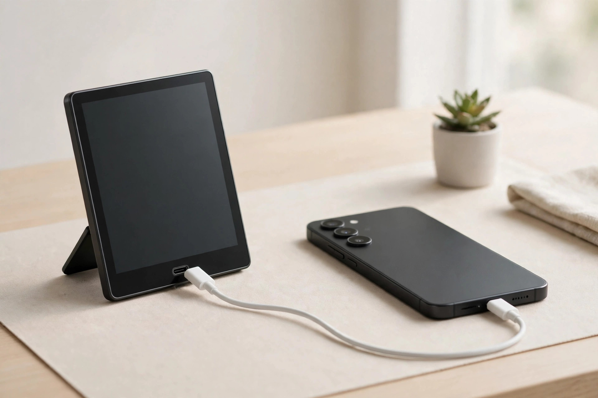

<!-- 본문 시작 -->
A Character Stands on Your Desk Without Glasses — Sony ELF-MN1, What to Check Before Buying

A figure on your desk never changes its expression or pose. Sony's **ELF-MN1**, announced on October 28, 2026, is a 6-inch display that sets a 3D character on your desk without glasses or a headset. This article is based on official materials and independent reporting. The product has not launched yet, so this is not a hands-on review.

403 ppi, the sharpest pixel density of any Sony spatial display. (Illustration)

## What It Is

The ELF-MN1 is the smallest model in Sony's Spatial Reality Display line. The earlier ELF-SR1 (15.6-inch, 2020) and ELF-SR2 (27-inch, 2023) were professional tools, and the 27-inch model cost around 550,000 yen in Japan (New Atlas, checked November 5, 2026). The ELF-MN1 is the first to bring this technology to everyday users.

It launches in Japan on December 11, 2026. The expected street price is about 54,000 yen (around $340, open price) (Sony XYN official announcement, checked November 11, 2026). Sony Stores in Ginza and Nagoya will show the real unit from November 20.

## What Stands Out

First, 3D without glasses. A micro-optical lens layer, a high-speed vision sensor, and a third-generation eye-recognition sensor track your eyes in real time and draw a different image for each eye. The effective 3D resolution is 1,080×2,160 at 403 ppi, the highest of any Sony spatial display (official specifications, checked November 11, 2026).

Second, it works more like a display case than a screen. You can call up officially licensed characters through Gugenka's HoloModel, show your own 3D models with Deskrium, or try Animates, an AI companion app. A Unity SDK and OpenXR support are included for developers.

Third, it connects with a single USB-C cable. Plug it into a phone or PC and it works right away, with built-in 1W stereo speakers and a microphone. It weighs 300 g (350 g with the stand).

Because the image is redrawn as your eyes move, you can see the character's side when you shift your head. But the effect is tuned to one person only. (Illustration)

> 핵심 한 줄
>
> ### **Put the glasses away, but check the conditions first. This is not a monitor for everyone.**

## What to Watch Out For

First, check whether your device is compatible. Phones must be recent models Sony lists, such as Xperia 1 V/5 V or later, Pixel 10/11, Galaxy S23 or later, or iPhone 15 or later. A PC needs Windows 11, a 6-core Core i5 or better, an RTX 2070 Super-class GPU or better, 16 GB or more of memory, and a USB-C port that supports 4K 60p output (Sony compatibility list, checked November 11, 2026). Not every USB-C port works — it must support DisplayPort Alternate Mode.

Second, what you can watch is limited. 3D only comes from compatible apps. Movie, streaming, and game apps are not in Sony's app list (as checked November 2, 2026, secondary reporting).

Third, the viewing conditions are strict. The 3D effect works only from 30 to 80 cm away, within 25 degrees of the center, and for one viewer at a time. A person sitting next to you sees a distorted image.

Finally, the AC adapter and USB cable are sold separately (Sony official announcement footnote). Bring the cable with your purchase.

The port must support DisplayPort Alternate Mode video output. (Illustration)

## Price and Availability

The Japan launch price is about 54,000 yen (roughly 500,000 won) (secondary reporting, checked November 11, 2026). There is no Korean launch announcement yet, and a direct import would need a separate check of the power adapter and warranty terms.

## My Take

It fits people who collect digital figures and avatars, like the characters in the compatible apps, and already own a compatible phone or PC. But the feel of the 3D effect and eye strain have no hands-on reviews yet, so seeing the real unit at an exhibition or waiting for early reviews is the safer move. For a general monitor or video viewing, a different product is the right choice.

## Key Facts

| Item | Details |
|---|---|
| Product | Sony ELF-MN1 (Spatial Reality Display) |
| Display | 6-inch LCD, effective 3D 1,080×2,160, 403 ppi |
| 3D viewing | 30–80 cm distance, within 25°, one viewer only |
| Size and weight | 110.7×154.6×111.8 mm with stand, 350 g |
| Connection and power | USB-C (DP Alt Mode required), adapter and cable sold separately |
| Compatible devices | Recent smartphones and Windows 11 PCs (see the main text) |
| Price and launch | Japan, December 11, 2026, about 54,000 yen; Korean launch unconfirmed |

## 함께 보면 좋은 글

- [A Touchscreen on a USB Hub — Dockcase 7-in-1, What to Check Before Buying](https://aitechnotesen.wordpress.com/2026/11/08/a-touchscreen-on-a-usb-hub-dockcase-7in1-what-to-check-before-buying/) — Another way to change how your desk works, with a touchscreen built into a hub.
- [Fold It Shut and the Lens Closes — OBSBOT Meet Flip, What to Check Before Buying](https://aitechnotesen.wordpress.com/2026/11/08/fold-it-shut-and-the-lens-closes-obsbot-meet-flip-what-to-check-before-buying/) — A webcam that protects your privacy by folding shut.
- [Stop Digging Through Your Bag — MagQuick, a Strap That Snaps On and Pulls Off](https://aitechnotesen.wordpress.com/2026/10/25/stop-digging-through-your-bag-magquick-a-strap-that-snaps-on-and-pulls-off/) — A strap that snaps on and pulls off so you stop digging through your bag.

## 출처

- [Sony XYN official announcement — ELF-MN1 launch](https://xyn.sony.net/en/news/2026-srd-elf-mn1_release)
- [Notebookcheck — Sony ELF-MN1 announcement](https://www.notebookcheck.net/Sony-unveils-ELF-MN1-6-inch-glasses-free-3D-display-for-viewing-anime-avatars-and-spatial-content.1435922.0.html)
- [New Atlas — Sony ELF-MN1 overview](https://newatlas.com/consumer-tech/sony-xyn-elf-mn1-spatial-reality-display/)
- [owl3d — Sony Spatial Reality Display guide](https://www.owl3d.com/guides/sony-spatial-reality-display)
<!-- 본문 끝 -->
