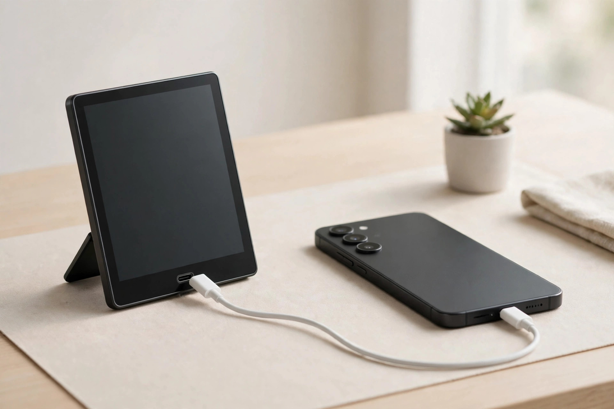

<!-- 본문 시작 -->
안경 없이 캐릭터가 책상 위에 선다 — 소니 ELF-MN1, 사기 전에 확인할 조건

책상 위 피규어는 표정도 자세도 바꾸지 않습니다. 소니가 2026년 10월 28일 발표한 **ELF-MN1**은 안경 없이 3D 캐릭터를 책상 위에 세워 보여주는 6인치 디스플레이입니다. 공식 자료와 독립 보도를 바탕으로 정리했으며, 출시 전이라 직접 사용한 후기가 아닙니다.

403ppi, 소니 공간 디스플레이 중 가장 촘촘합니다. (일러스트)

## 제품의 정체

ELF-MN1은 소니의 Spatial Reality Display 라인에서 나온 가장 작은 모델입니다. 앞선 ELF-SR1(15.6인치, 2020년)과 ELF-SR2(27인치, 2023년)는 전문가용이었고, 27인치 모델은 일본 기준 약 55만 엔대였습니다(New Atlas, 2026-11-05 확인). ELF-MN1은 이 기술을 일반 사용자용으로 처음 내린 제품입니다.

2026년 12월 11일 일본에서 먼저 출시합니다. 예상 판매가는 약 54,000엔(약 340달러, 오픈 프라이스)입니다(소니 XYN 공식 발표, 2026-11-11 확인). 11월 20일부터 소니 스토어 긴자·나고야에서 실물을 볼 수 있습니다.

## 눈에 띄는 특징

첫째, 안경 없이 3D가 보입니다. 마이크로 광학 렌즈와 고속 비전 센서·3세대 눈 인식 센서가 눈 위치를 실시간으로 쫓아 양쪽 눈에 다른 영상을 그려줍니다. 3D 실효 해상도 1,080×2,160, 403ppi로 소니 공간 디스플레이 중 가장 높습니다(공식 사양, 2026-11-11 확인).

둘째, 화면이 아니라 '진열장'에 가깝습니다. 공식 라이선스 캐릭터를 부르는 HoloModel(구겐카)을 쓸 수 있고, 직접 만든 3D 모델을 띄우는 Deskrium, AI 동반자 Animates 같은 앱도 준비돼 있습니다.

셋째, 연결은 USB-C 케이블 하나입니다. 폰이나 PC에 꽂으면 바로 쓸 수 있고, 1W 스테레오 스피커와 마이크가 내장돼 있습니다. 300g(스탠드 포함 350g)입니다.

눈을 따라 영상을 다시 그려 고개를 움직여도 캐릭터의 옆모습이 보입니다. 단, 한 사람에게만 맞춰집니다. (일러스트)

> 핵심 한 줄
>
> ### **안경은 벗고, 조건은 먼저 확인하자. 이 화면은 모두를 위한 모니터가 아니다.**

## 아쉬운 점

먼저 확인할 것은 내 기기가 호환되는지입니다. 폰은 Xperia 1 V·5 V 이상, Pixel 10·11, Galaxy S23 이상, iPhone 15 이상 등 소니가 밝힌 최신 기종이 필요합니다. PC는 Windows 11, 6코어 Core i5 이상, RTX 2070 Super급 이상, 16GB 이상 메모리, 4K 60p 출력 USB-C 포트가 필요합니다(소니 호환 목록, 2026-11-11 확인). USB-C 포트라도 영상 출력(DP Alt Mode) 지원 여부를 따져야 합니다.

둘째, 볼 수 있는 것이 정해져 있습니다. 3D는 대응 앱에서만 나옵니다. 영화·스트리밍·게임 앱은 소니 앱 목록에 없습니다(2026-11-02 확인 기준, 2차 보도).

셋째, 시청 조건이 까다롭습니다. 3D 효과는 30~80cm, 중심에서 최대 25도 안에서 한 사람에게만 제대로 보입니다. 옆 사람에게는 왜곡돼 보입니다.

AC 어댑터와 USB 케이블은 별도 판매입니다(소니 공식 발표 각주). 케이블까지 함께 챙겨야 합니다.

영상 출력(DP Alt Mode) 지원 포트여야 연결됩니다. (일러스트)

## 가격과 국내 이용

일본 출시가는 약 54,000엔(약 50만 원 안팎)입니다(2차 보도, 2026-11-11 확인).

## 에디터의 판단

디지털 피규어·아바타 취미가 있고, 대응 앱 캐릭터가 마음에 들며, 호환 폰·PC가 이미 있는 분께 어울립니다. 다만 3D 체감 품질과 눈의 피로도는 실사용 후기가 없어 실물 전시나 초기 리뷰를 먼저 보는 편이 안전합니다. 일반 모니터나 영상 감상용이라면 다른 제품이 맞습니다.

## 핵심 정보

| 항목 | 내용 |
|---|---|
| 제품명 | 소니 ELF-MN1 (Spatial Reality Display) |
| 화면 | 6인치 LCD, 3D 실효 1,080×2,160, 403ppi |
| 3D 시청 조건 | 거리 30~80cm·25도 이내·1인 시청 |
| 크기·무게 | 스탠드 포함 110.7×154.6×111.8mm·350g |
| 연결·전원 | USB-C(DP Alt Mode 필수), 어댑터·케이블 별도 판매 |
| 호환 기기 | 최신 스마트폰·Win 11 PC(본문 참조) |
| 가격·출시 | 일본 2026-12-11 출시, 약 54,000엔, 한국 출시 미확인 |

## 함께 보면 좋은 글

- [책상만 밝히고 화면은 건드리지 않는다 — BenQ ScreenBar Halo 2, 사기 전에 확인할 조건](https://blog.naver.com/3700708/224471119531) — 책상 위 조명을 바꾸는 또 다른 방법을 정리한 글입니다.
- [귀를 막지 않고 달린다 — Shokz OpenRun Pro 2, 사기 전에 확인할 조건](https://blog.naver.com/3700708/224471119035) — 몸에 걸치는 기기로 일상을 넓히는 또 다른 방법을 소개합니다.
- [주간 AI 뉴스 모음｜매주 AI 소식, 한 번에 따라가기](https://blog.naver.com/3700708/224464427593) — 매주 AI 소식을 한 번에 따라갈 수 있는 모음 글입니다.

## 출처

- [소니 XYN 공식 발표 — ELF-MN1 출시](https://xyn.sony.net/en/news/2026-srd-elf-mn1_release)
- [Notebookcheck — 소니 ELF-MN1 발표 기사](https://www.notebookcheck.net/Sony-unveils-ELF-MN1-6-inch-glasses-free-3D-display-for-viewing-anime-avatars-and-spatial-content.1435922.0.html)
- [New Atlas — 소니 ELF-MN1 소개](https://newatlas.com/consumer-tech/sony-xyn-elf-mn1-spatial-reality-display/)
- [owl3d — 소니 Spatial Reality Display 가이드](https://www.owl3d.com/guides/sony-spatial-reality-display)
<!-- 본문 끝 -->
