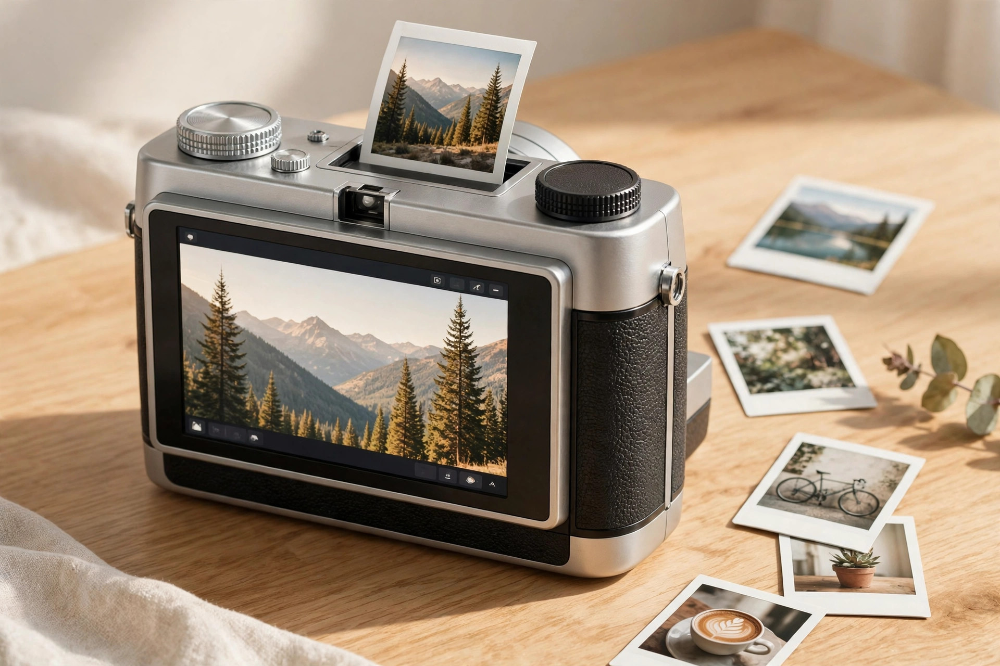

<!-- 본문 시작 -->
# Pick Before You Print — Fujifilm instax mini Evo 2, What to Check Before Buying

With an instant camera, the moment you shoot is the moment you print. If you have ever hesitated over the shutter because a sheet of film felt too precious to waste, Fujifilm's hybrid approach will catch your eye. You shoot digitally and print only the photos you like. The follow-up in that line, the instax mini Evo 2, was announced on October 27, 2026, and is due out at the end of November (Fujifilm North America announcement, checked 2026-10-27).

(Illustration) The rear touchscreen is the biggest change in this model.

## The Product — A Bigger Screen and a Bigger Sensor

The back of the Evo 2 is taken up by a 4.5-inch LCD touchscreen. To be precise, it is 4.46 inches with about 1.23 million dots. It is the first touchscreen in the instax line (Fujifilm North America announcement, checked 2026-10-27). It is bigger and sharper than the original, which makes picking photos much easier.

The sensor has grown too. It is a 1/2.77-inch CMOS sensor with about 16.3 megapixels effective, with roughly 3.3 times the area of the 1/5-inch sensor in the original (TechTimes analysis, checked 2026-10-27). The lens is a 21mm equivalent at f/2.0, wider than the original's 28mm, and face-detection autofocus is new.

> The fun comes first in choosing
> ### **A camera you pick from, then print**

Prints are made on instax mini film (2×3 inches) at 600 dpi. You can choose between Rich Mode and Natural Mode for color. Ten lens effects and ten film effects combine into 100 looks. Exposure, white balance, and flash are adjusted with analog-style dials, and macro mode and a selfie mirror are still there. Printing photos from a smartphone and remote shooting are handled by the companion app (app available November 24, 2026, Camera Jabber, checked 2026-10-27).

## The Fun Part — It Records the Four Seconds Before the Shot

Two new features show this camera's character. The first is instax Expanded View. It shows a wider field of view than the shooting area on screen, with a framing guide, so you can compose while seeing beyond the frame. The second is instax Immersive Movie. It saves the four seconds before each photo as a short video clip. A microSD card is required for this feature (Fujifilm North America announcement, checked 2026-10-27).

(Illustration) Seeing beyond the frame is what changes the way you compose.

## The Realistic Limits — A Bigger Sensor Does Not Mean Better Prints

There is one expectation to adjust. A bigger sensor does not mean more detail in the print. Because of the chemical resolving power of instax mini film, the detail a print can reproduce stays at about 1.6 megapixels, according to one analysis (TechTimes analysis, checked 2026-10-27). The sensor upgrade benefits the digital files saved to microSD first.

Film and a microSD card are also sold separately. The spec sheet lists about 90 prints per charge (Camera Jabber spec summary, checked 2026-10-27), but there is no independent verification of real-world battery life yet. Since the announcement is recent, there are almost no hands-on reviews. This article is a pre-purchase guide based on announcement materials and press coverage, not a hands-on review.

## Buying Information — Price and Release Schedule

| Item | Details |
|---|---|
| US price | $289.95 |
| Canada price | $379.99 CAD |
| UK and Europe price | £229.99 / €269 |
| Japan price | About ¥42,900 (estimated market price) |
| Release | End of November 2026 (US), November 27 in Japan |
| Korea release | Unconfirmed (checked 2026-11-11) |

The original mini Evo launched at $199 (dclee.net summary, checked 2026-10-27). The new model costs about $91 more. Since the Korea price and release date are unconfirmed, check import duties and warranty terms separately if you are considering buying from overseas.

(Illustration) A freshly printed photo. Printing is still this camera's final step and its greatest pleasure.

## My Take — Who It Suits

The instax mini Evo 2 suits someone looking for an instant camera that wastes little film. You shoot digitally, pick, and then print, so there is less wasted film and no printing of failed shots. If you often take photos at gatherings and on trips, the pick-then-print structure itself lowers running costs. On the other hand, it may not suit you if you expect high-resolution prints.

Three things to check before buying. First, the Korea release price and schedule. Second, the separate cost of film and a microSD card. Third, if you plan to use Immersive Movie, prepare a microSD card together with the camera. Check just these three, and this camera can stay fun to use for a long time.

## Recommended Reading

- [A Touchscreen on a USB Hub — Dockcase 7-in-1, What to Check Before Buying](https://aitechnotesen.wordpress.com/2026/11/08/a-touchscreen-on-a-usb-hub-dockcase-7in1-what-to-check-before-buying/) — Another new desk gadget, with a pre-purchase checklist.
- [Fold It Shut and the Lens Closes — OBSBOT Meet Flip, What to Check Before Buying](https://aitechnotesen.wordpress.com/2026/11/08/fold-it-shut-and-the-lens-closes-obsbot-meet-flip-what-to-check-before-buying/) — A webcam with a folding privacy cover, and what to check before buying.
- [Stop Digging Through Your Bag — MagQuick, a Strap That Snaps On and Pulls Off](https://aitechnotesen.wordpress.com/2026/10/25/stop-digging-through-your-bag-magquick-a-strap-that-snaps-on-and-pulls-off/) — A strap that snaps on and pulls off, for carrying small gear.

## Sources

- FUJIFILM North America press release: [Fujifilm Introduces instax mini Evo 2 Hybrid Instant Camera](https://newsroom-us.fujifilm.com/press-releases/press-release-details/2026/Fujifilm-Introduces-instax-mini-Evo-2-Hybrid-Instant-Camera/default.aspx)
- PetaPixel: [The Instax Mini Evo 2 Has a Bigger Display and Expanded Field of View](https://petapixel.com/2026/10/26/the-instax-mini-evo-2-has-a-bigger-display-and-expanded-field-of-view/)
- Camera Jabber: [Fujifilm instax mini Evo 2 price, specifications and availability announced](https://camerajabber.com/photography-news/fujifilm-instax-mini-evo-2-price-specifications-and-availability-announced/)
- TechTimes: [Fujifilm Instax Mini Evo 2: Sensor Area Tripled, Touchscreen Added; Prints Stay at 1.6MP](https://www.techtimes.com/articles/329553/20261027/fujifilm-instax-mini-evo-2-sensor-area-tripled-touchscreen-added-prints-stay-16mp.htm)
- dclee.net: [instax mini Evo 2: Price, Release Date, and First Take](http://www.dclee.net/blog/instax-mini-evo-2)
<!-- 본문 끝 -->
