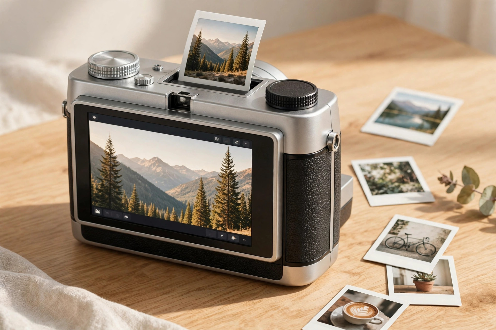

<!-- 본문 시작 -->
# 찍기 전에 골라서 뽑는다 — 인스탁스 미니 Evo 2, 사기 전에 확인할 조건

즉석카메라는 찍는 순간이 곧 인화다. 필름 한 장이 아까워 셔터를 망설인 적이 있다면, 후지필름의 하이브리드 방식이 눈에 들어온다. 디지털로 찍고, 마음에 드는 사진만 골라 뽑는 방식이다. 후속작 인스탁스 미니 Evo 2가 2026년 10월 27일 발표됐고, 11월 말 출시를 앞두고 있다(후지필름 북미 발표, 2026-10-27 확인).

(일러스트) 뒷면 터치스크린이 이번 모델의 가장 큰 변화다.

## 제품 소개 — 화면이 커지고, 센서가 커졌다

Evo 2의 뒷면은 4.5인치 LCD 터치스크린이 차지한다. 정확히는 4.46인치, 약 123만 도트다. 인스탁스 라인에서 터치스크린이 들어간 것은 이 모델이 처음이다(후지필름 북미 발표, 2026-10-27 확인). 전작보다 크고 선명해 사진 고르기가 훨씬 편해졌다.

센서도 키웠다. 1/2.77인치 CMOS, 약 1,630만 화소 유효로, 전작의 1/5인치 센서보다 면적이 약 3.3배 넓다(TechTimes 분석, 2026-10-27 확인). 렌즈는 21mm 상당, f/2.0으로 전작의 28mm보다 넓어졌고, 얼굴인식 자동초점이 새로 들어갔다.

> 고르는 재미가 먼저다
> ### **골라서 뽑는 카메라**

인화는 instax mini 필름(2×3인치)에 600dpi로 이뤄진다. Rich Mode와 Natural Mode 중 색감을 고를 수 있다. 렌즈 효과 10종과 필름 효과 10종을 조합하면 100가지 표현이 나온다. 노출·화이트밸런스·플래시는 아날로그식 다이얼로 조절하고, 매크로 모드와 셀피 미러도 그대로 있다. 스마트폰 사진 인화와 원격 촬영은 전용 앱이 맡는다(앱 제공 2026년 11월 24일, Camera Jabber, 2026-10-27 확인).

## 재미있는 점 — 사진 찍기 전 4초를 담는다

새 기능 두 가지가 이 카메라의 성격을 보여준다. 첫째는 instax Expanded View다. 촬영 영역보다 넓은 화각을 화면에 보여주고 프레이밍 가이드를 표시해, 화면 밖까지 보고 구도를 잡게 한다. 둘째는 instax Immersive Movie다. 사진을 찍기 전 4초를 짧은 영상으로 저장하는 기능이다. 단, 이 기능에는 microSD 카드가 반드시 필요하다(후지필름 북미 발표, 2026-10-27 확인).

(일러스트) 화면 밖까지 보이는 것이 구도를 바꾸는 지점이다.

## 현실적 한계 — 센서가 커져도 인화물은 그대로다

다만 센서가 커졌다고 인화물의 디테일까지 커지는 것은 아니다. instax mini 필름의 화학 분해능 한계로, 인화물로 재현되는 디테일은 약 160만 화소 수준에 머문다는 분석이 있다(TechTimes 분석, 2026-10-27 확인). 센서 업그레이드의 혜택은 microSD에 저장되는 디지털 파일 쪽에 먼저 돌아간다.

또 필름과 microSD 카드는 별도 구매다. 1회 충전으로 약 90장을 인화할 수 있다는 스펙 표기가 있으나(Camera Jabber 스펙 정리, 2026-10-27 확인), 실제 사용 환경에서의 지속 시간은 독립 검증이 아직 없다. 발표 직후라 실사용 후기가 거의 없는 점도 감안해야 한다. 이 글은 발표 자료와 보도 기준의 구매 전 정보다.

## 구매 정보 — 가격과 출시 일정

| 항목 | 내용 |
|---|---|
| 미국 가격 | 289.95달러 |
| 캐나다 가격 | 379.99캐나다달러 |
| 영국·유럽 가격 | 229.99파운드 / 269유로 |
| 일본 가격 | 약 42,900엔(추정 시장가) |
| 출시 | 2026년 11월 말(미국), 일본 11월 27일 |
| 한국 출시 | 미확인(2026-11-11 확인 기준) |

전작 미니 Evo의 출시가는 199달러였다(dclee.net 정리, 2026-10-27 확인). 새 모델은 약 91달러 올랐다. 국내 가격·출시일은 미확인이라, 직구 시 관세와 보증 조건을 따로 확인하는 것이 좋다.

(일러스트) 막 뽑은 인화 사진. 인화는 이 카메라의 마지막 단계이자 가장 큰 즐거움이다.

## 나의 판단 — 이런 사람에게 맞는다

인스탁스 미니 Evo 2는 '필름 아끼는 즉석카메라'를 찾는 사람에게 맞는다. 디지털로 찍어 고른 뒤 뽑으니 필름 낭비가 적고, 실패작을 인화할 일도 없다. 모임·여행 사진을 자주 찍는다면, 골라 뽑는 구조 자체가 유지비를 낮춘다. 반대로 인화물의 고화질을 기대한다면 맞지 않을 수 있다.

확인할 조건은 세 가지다. 첫째, 국내 출시 가격과 일정. 둘째, 필름과 microSD 카드의 별도 구매 비용. 셋째, Immersive Movie를 쓴다면 microSD 카드를 함께 준비할 것. 이 세 가지만 확인하면 오래 쓸 수 있는 물건이다.

## 함께 보면 좋은 글

- [책상만 밝히고 화면은 건드리지 않는다 — BenQ ScreenBar Halo 2, 사기 전에 확인할 조건](https://blog.naver.com/3700708/224471119531) — 책상 위 빛을 다루는 또 다른 신제품, 사기 전 체크리스트.
- [귀를 막지 않고 달린다 — Shokz OpenRun Pro 2, 사기 전에 확인할 조건](https://blog.naver.com/3700708/224471119035) — 운동하며 쓰기 좋은 오픈형 이어폰, 구매 전 확인할 조건.
- [주간 AI 뉴스 모음｜매주 AI 소식, 한 번에 따라가기](https://blog.naver.com/3700708/224464427593) — 한 주간의 AI 소식을 한 번에 따라가는 정리 글.

## 출처

- FUJIFILM North America 보도자료: [Fujifilm Introduces instax mini Evo 2 Hybrid Instant Camera](https://newsroom-us.fujifilm.com/press-releases/press-release-details/2026/Fujifilm-Introduces-instax-mini-Evo-2-Hybrid-Instant-Camera/default.aspx)
- PetaPixel: [The Instax Mini Evo 2 Has a Bigger Display and Expanded Field of View](https://petapixel.com/2026/10/26/the-instax-mini-evo-2-has-a-bigger-display-and-expanded-field-of-view/)
- Camera Jabber: [Fujifilm instax mini Evo 2 price, specifications and availability announced](https://camerajabber.com/photography-news/fujifilm-instax-mini-evo-2-price-specifications-and-availability-announced/)
- TechTimes: [Fujifilm Instax Mini Evo 2: Sensor Area Tripled, Touchscreen Added; Prints Stay at 1.6MP](https://www.techtimes.com/articles/329553/20261027/fujifilm-instax-mini-evo-2-sensor-area-tripled-touchscreen-added-prints-stay-16mp.htm)
- dclee.net: [instax mini Evo 2: Price, Release Date, and First Take](http://www.dclee.net/blog/instax-mini-evo-2)
<!-- 본문 끝 -->
