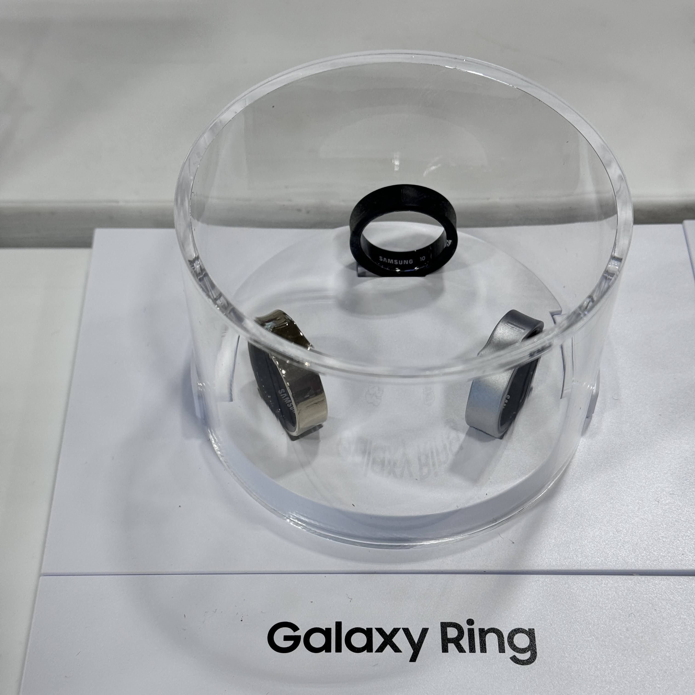
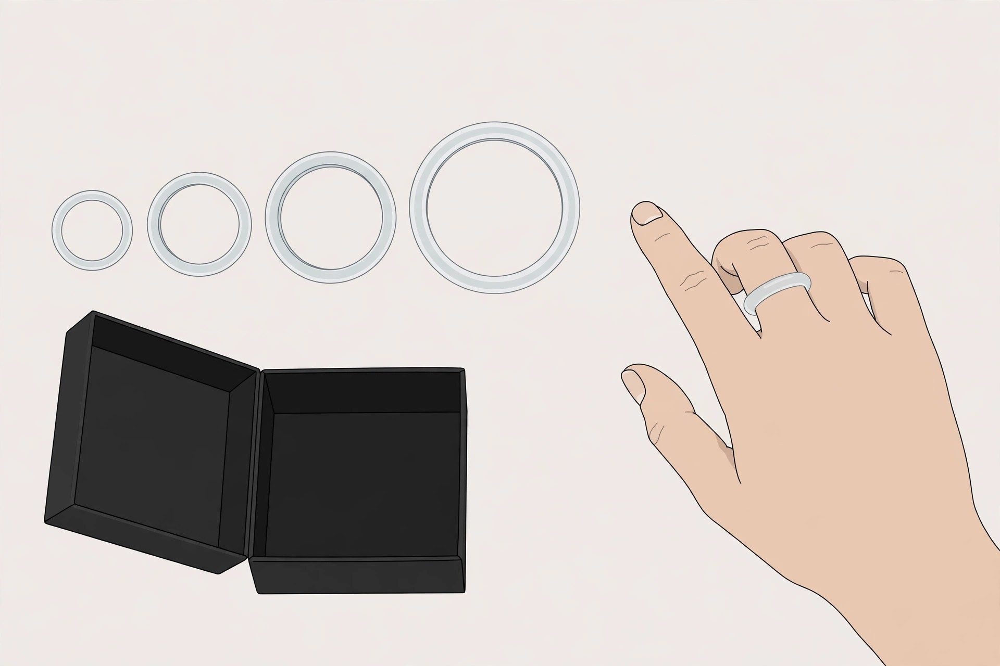
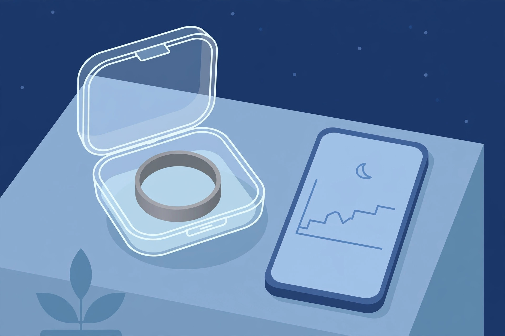

<!-- 본문 시작 -->
A Ring That Tracks Your Health While You Sleep — Samsung Galaxy Ring: What to Check Before Buying

Anyone who has found sleeping with a watch uncomfortable has probably wondered: how nice would it be if a ring with no screen and almost no weight could track your sleep? The Samsung Galaxy Ring is that idea turned into a ring-shaped health tracker. Now that its price has come down, the conditions to check before buying are clearer than ever.

A real product photo taken at the launch event in July 2024. Source: Wikimedia Commons, photo by Miyako Fujimiya.

> The key point
>
> ### **There is no subscription fee — but first check whether your phone can even use it**

## What is this ring?

The Galaxy Ring is a health tracker that packs three sensors into a titanium ring. According to Samsung's official page (checked 2026-11-13), an accelerometer, an optical bio-signal sensor, and a skin temperature sensor measure changes in heart rate, sleep, and skin temperature. It has no screen, so results are viewed in the Samsung Health app. Sleep Score, Energy Score, snore detection, heart-rate alerts, automatic walking and running detection, and cycle tracking are listed as official features. Samsung distinguishes these as general wellness features, not medical ones.

| Item | Details |
|---|---|
| Product | Samsung Galaxy Ring (unveiled July 2024) |
| Weight and size | 2.3–3.0 g · 7.0 mm wide · 2.6 mm thick (varies by size, per the manufacturer) |
| Battery | Up to 6–7 days (by size), up to about 14 days with the charging case (manufacturer claim) |
| Compatibility | Android 11 or later; no iPhone support (checked 2026-11-13) |
| Subscription | None (for Samsung Health and Galaxy AI features) |
| US list price | $399.99 (checked 2026-11-13, Samsung US) |

## What "no subscription" really means

With smart rings, "no subscription" matters more than it sounds. The Oura Ring 4 starts at $349 for the ring itself, but its membership costs $5.99 a month or $69.99 a year (US pricing, per Oura's official guidance, checked 2026-11-13), and key features such as detailed sleep staging and recovery analysis sit behind it. Over three years, the Oura Ring 4 adds about $210 of membership to its $349 price, reaching about $559. The Galaxy Ring ends at $399.99, paid once. One caveat: reports say the Oura Ring 5 launched in May 2026 starting at $399, so if you are considering the Ring 4, check whether its price is a previous-generation price.

## The sizing kit comes first

Get the size wrong on a ring and the fit, the exchange, and everything else goes wrong with it. Samsung sends the sizing kit for free and advises wearing a sample ring for at least 24 hours before deciding (Samsung official page, checked 2026-11-13). It also notes that Galaxy Ring sizes can differ from standard ring sizes. Sizes were US 5–13 at launch, and two more sizes were added later, so US 5–15 are now available. Fingers swell and shrink through the day, so a day of trying the sample on in the morning and evening is effectively essential.

(Illustration) Trying on a sample ring for at least 24 hours before deciding is the first step of the purchase.

## The Android-only catch

The first condition to check is your phone. The Galaxy Ring works only on Android 11 or later, and iPhone is not supported (Samsung official guidance, checked 2026-11-13). There is one more layer: Samsung's page footnotes say signature features such as Energy Score, snore detection, Double Pinch, and Find My Ring require a compatible Galaxy phone. An Android phone will connect, but without a Galaxy phone you may miss some of the features shown in the ads. For iPhone users, this ring is not an option at all.

(Illustration) According to the manufacturer, the charging case extends use to up to about 14 days without an outlet.

## Shortcomings and things to check

Battery life is where the manufacturer's claim and independent reviews diverge. Samsung says up to 6–7 days depending on size, and up to about 14 days with the charging case. Across independent reviews, 5–7 days in real use is common. "Up to" is not a guarantee. One battery-swelling case was reported in 2025, and Samsung described it as an extremely rare case. There is no failure-rate data, but teardown specialist iFixit reports that the battery is sealed in, making replacement practically impossible. The absence of ECG and blood-pressure sensors is also worth noting, as is the fact that the timing of sleep-apnea detection in Korea is unconfirmed. Reports also suggest a successor, the Galaxy Ring 2, could arrive in early 2027, so buying now may mean buying the previous generation.

## Price and availability in Korea

The official US list price is $399.99 (checked 2026-11-13). Yet 9to5Google reported a case of the ring dropping to $324.99 on Amazon in late October 2026 (2026-10-28). It may be a bad time to pay full price. The launch price in Korea was 499,000 won, but the current domestic price is unconfirmed. Buyers in Korea should check the current price and whether the sizing kit is included at an official sales channel.

## My verdict

The Galaxy Ring suits Galaxy phone owners who want to track sleep and daily condition without wearing a watch to bed. No subscription is a clear advantage over three years. It does not suit iPhone users, people whose main interest is workout tracking, or anyone who wants to see results on a screen right away. If you buy one, the order is fixed: check whether your phone is Android, and a Galaxy phone; spend a day with the sizing kit; and wait for a discount.

## You may also like

- [A Touchscreen on a USB Hub — Dockcase 7-in-1: What to Check Before Buying](https://aitechnotesen.wordpress.com/2026/11/08/a-touchscreen-on-a-usb-hub-dockcase-7in1-what-to-check-before-buying/)
  A USB-C hub with a touchscreen — what to check before buying.
- [Fold It Shut and the Lens Closes — OBSBOT Meet Flip: What to Check Before Buying](https://aitechnotesen.wordpress.com/2026/11/08/fold-it-shut-and-the-lens-closes-obsbot-meet-flip-what-to-check-before-buying/)
  A webcam whose lens closes when you fold it — what to check before buying.
- [A Keyboard Where Lifting a Typewriter Lever Presses Enter — Epomaker Glyph: What to Check Before Buying](https://aitechnotesen.wordpress.com/2026/11/03/a-keyboard-where-lifting-a-typewriter-lever-presses-enter-epomaker-glyph-what-to-check-before-buying/)
  A keyboard with a typewriter lever — what to check before buying.

## Sources

- [Samsung Galaxy Ring official product page](https://www.samsung.com/us/rings/galaxy-ring/)
- [Samsung Galaxy Ring buy page (US list price)](https://www.samsung.com/us/rings/galaxy-ring/buy/galaxy-ring-titanium-gold-size-15-sku-sm-q515nzdaxar/)
- [Oura Ring 4 official store](https://ouraring.com/store/rings/oura-ring-4)
- [Oura buying guide (price and membership)](https://ouraring.com/blog/oura-ring-what-to-know-2026/)
- [9to5Google — Galaxy Ring update and $75-off sale report (2026-10-28)](https://9to5google.com/2026/10/28/the-galaxy-ring-got-a-new-update-just-in-time-for-a-75-off-sale/)
- [Welltory — Galaxy Ring overview (price, battery, Oura comparison)](https://welltory.com/blog/samsung-galaxy-ring)
- [SleepyHero — Samsung Galaxy Ring review 2026](https://sleepyhero.com/sleep-trackers/samsung-galaxy-ring)
- [iFixit — Galaxy Ring teardown](https://www.ifixit.com/News/98423/samsungs-galaxy-ring-revealed?srsltid=AfmBOooTTarOLGXH50-aP5-YNJdA0e9-Bc-0YoSHonj8dMV2Ox_BU1tO)
<!-- 본문 끝 -->
