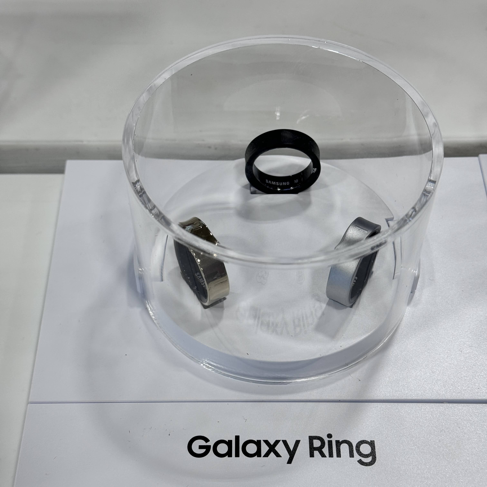
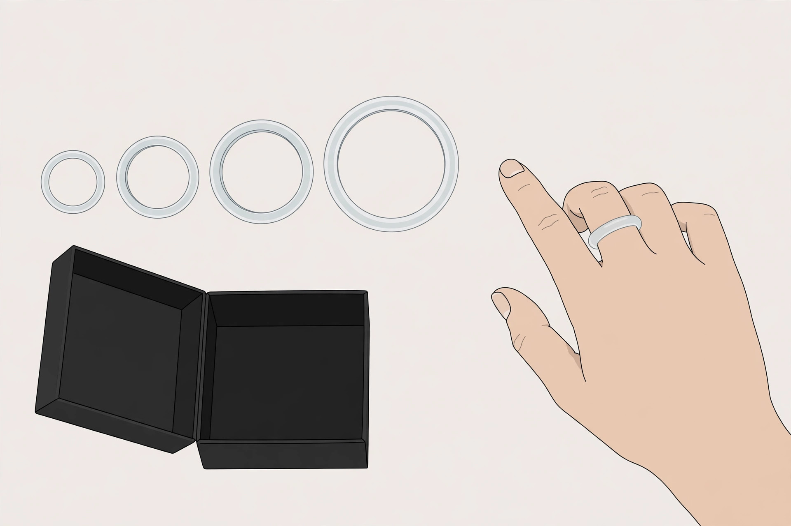
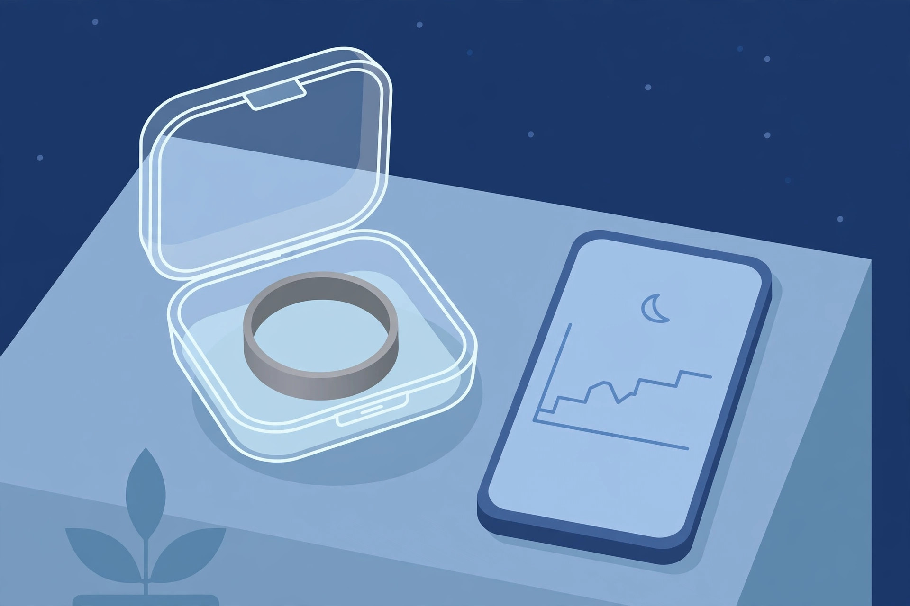

<!-- 본문 시작 -->
갤럭시 링｜잠자는 동안 건강 재는 반지, 사이즈·가격 확인

> 시계 차고 자는 게 불편한데, 수면 기록은 포기하기 아쉽다.
> **구독료 없이 3년이면 오우라보다 약 160달러 싸다.**
> 갤럭시폰인지부터 확인하고, 사이즈 키트로 하루를 보내자.

시계를 차고 자기 불편했던 사람이라면 한 번쯤 생각해봤을 것이다. **화면도 무게도 없는 반지**가 잠을 재주면 얼마나 편할까. 삼성 갤럭시 링은 그 생각을 담은 반지형 건강 기록 기기다. 이 글은 삼성 공식 자료와 독립 리뷰를 모아 정리했다.

가격이 내린 지금, 사기 전에 확인할 조건이 더 또렷해졌다. 반지는 한 번 사면 바꾸기 어렵다. **사이즈부터 폰 호환까지**, 살 때 따져야 할 것을 순서대로 정리한다.

2024년 7월 공개 행사에서 촬영된 실제 제품 사진이다. 출처: Wikimedia Commons, Miyako Fujimiya 촬영.

## 이 반지는 무엇인가

화면이 없는 대신 손가락에서 잰다. 갤럭시 링은 티타늄 반지 안에 **센서 세 개**를 넣은 건강 기록 기기로, 가속도계·광학 생체신호 센서·피부 온도 센서가 심박과 수면, 피부 온도 변화를 잰다. 결과는 삼성 헬스 앱에서 본다.

수면 점수·에너지 점수·코골이 감지·심박 알림·걷기 달리기 자동 감지·생리 주기 추적이 공식 기능이다. 삼성은 이를 의료용이 아니라 **일반 웰니스 기능**으로 구분한다.

| 항목 | 내용 |
|---|---|
| 제품 | 삼성 갤럭시 링 (2024년 7월 공개) |
| 무게·크기 | 2.3~3.0g · 너비 7.0mm · 두께 2.6mm (크기별 차이, 제조사 표기) |
| 배터리 | 최대 6~7일 (크기별), 충전 케이스 포함 최대 약 14일 (제조사 주장) |
| 호환 | 안드로이드 11 이상, 아이폰 미지원 (2026-11-13 확인) |
| 구독료 | 없음 (삼성 헬스·갤럭시 AI 기능 기준) |
| 미국 정가 | 399.99달러 (2026-11-13 확인, 삼성 US 기준) |

## 구독료 0원, 3년이면 얼마나 아낄까?

3년으로 계산하면 **약 160달러 차이**가 난다. 오우라 링 4는 본체가 349달러부터다. 멤버십은 월 5.99달러, 연 69.99달러이며 자세한 수면 단계와 회복 분석 같은 핵심 기능이 멤버십 뒤에 있다.

멤버십 3년분은 약 210달러다. 오우라는 3년이면 약 559달러가 된다. 갤럭시 링은 399.99달러 한 번으로 끝난다.

다만 오우라 링 5가 399달러부터 출시됐다는 보도도 있다. 2026년 5월 출시라 링 4는 **구세대 가격인지** 따져봐야 한다.

| 대상 | 핵심 값 | 고를 때 |
|---|---|---|
| 갤럭시 링 | 399.99달러 1회, 구독료 0원 | 갤럭시폰으로 수면 기록이 목적일 때 |
| 오우라 링 4 | 349달러 + 멤버십 월 5.99달러, 3년 약 559달러 | 멤버십 뒤의 상세 분석이 필요할 때 |

## 사이즈 키트, 먼저 받아야 하는 이유

반지는 **사이즈를 틀리면** 교환도 착용감도 모두 틀어진다. 삼성은 사이즈 키트를 무료로 보내주고 샘플 반지를 **24시간 이상** 껴본 뒤 결정하라고 안내한다. 일반 반지 사이즈와 다를 수 있다는 단서도 있다.

사이즈는 출시 당시 5~13호였다. 이후 2개가 추가돼 지금은 5~15호까지 고를 수 있다. 손가락은 하루에도 붓고 빠지니 샘플을 **아침저녁으로** 껴보는 하루가 필수다.

(일러스트) 샘플 링을 24시간 이상 껴보고 정하는 과정이 구매의 첫 단계다.

## 안드로이드 전용이라는 함정

아이폰이면 **선택지에 없다**. 갤럭시 링은 안드로이드 11 이상에서만 쓸 수 있고 아이폰은 지원하지 않는다. 한 단계가 더 남았다. 에너지 점수·코골이 감지·더블 핀치·분실 찾기 같은 대표 기능은 호환되는 갤럭시폰이 필요하다고 삼성 페이지 각주에 적혀 있다.

안드로이드폰이면 연결은 되지만 갤럭시폰이 아니면 **광고 속 기능 일부**를 못 쓸 수 있다. 사기 전 내 폰이 갤럭시폰인지부터 확인하는 게 순서다.

(일러스트) 충전 케이스와 함께면 최대 약 14일까지 콘센트 없이 쓸 수 있다는 게 제조사 설명이다.

## 배터리는 광고만큼 갈까?

광고의 '최대'라는 말은 **보장값이 아니다**. 삼성은 크기에 따라 최대 6~7일이라고 안내한다. 충전 케이스와 함께면 최대 약 14일이다. 독립 리뷰를 종합하면 실사용은 5~7일 안팎이 흔하다.

또 2025년 배터리 부풀림 사례 1건이 보도됐고 삼성은 '극히 드문 사례'라고 밝혔다. 고장률 데이터는 없지만, 분해 전문 매체 iFixit는 배터리가 밀봉돼 **교체가 사실상 불가능**한 구조라고 전한다. 심전도·혈압 센서가 없는 점, 수면 무호흡 감지의 국내 적용 시점이 미확인인 점도 체크 목록에 넣어두자.

후속작 갤럭시 링 2가 2027년 초 나올 수 있다는 보도도 있다. 지금 사면 **구세대를 사는 셈**이 될 수 있다.

## 가격과 국내 이용

미국 공식 정가는 **399.99달러**다. 그런데 아마존에서 324.99달러까지 내린 사례가 보도됐다(9to5Google). 정가로 사기엔 아까운 시기일 수 있다.

국내 출시 당시 가격은 499,000원이었으나 현재 국내 판매가는 미확인이다. 국내에서 사려면 공식 판매처의 **현재 가격과 사이즈 키트** 제공 여부를 직접 확인해야 한다.

## 나의 판단

갤럭시 링은 갤럭시폰을 쓰면서 시계 없이 수면·컨디션 흐름을 기록하고 싶은 사람에게 어울린다. **구독료가 없다는 점**은 3년 기준으로 확실한 장점이다. 반대로 아이폰 사용자, 운동 기록이 주 목적인 사람, 화면에서 바로 결과를 보고 싶은 사람에게는 맞지 않는다.

- 갤럭시폰인지 확인한다, 아이폰이면 선택지에서 제외
- 사이즈 키트로 샘플을 하루 껴본다
- 399.99달러 정가보다 낮은 할인 시기를 노린다

갤럭시폰이 있고 수면 기록이 목적이라면, 지금은 할인 시기를 노릴 때다.

## 함께 읽으면 좋은 글

[후지필름 X half｜하프프레임 디지털 카메라, 79만 원](https://blog.naver.com/3700708/224480043492)

하프프레임의 재미를 79만 원에 담았는지, 사기 전에 확인할 조건을 정리한 글이다.

[사운드코어 Sleep A30｜코골이 가리는 수면 이어버드, 3가지 조건](https://blog.naver.com/3700708/224479995584)

코골이를 가리는 수면 이어버드, 사기 전에 확인할 3가지 조건을 정리한 글이다.

[GPT-6 사이버｜가장 강력한 AI가 공개되지 않는 이유](https://blog.naver.com/3700708/224477518377)

가장 강력한 AI가 왜 공개되지 않는지, AI 뉴스로 정리한 글이다.

## 출처

- [삼성 갤럭시 링 공식 제품 페이지](https://www.samsung.com/us/rings/galaxy-ring/)
- [삼성 갤럭시 링 구매 페이지 (미국 정가 확인)](https://www.samsung.com/us/rings/galaxy-ring/buy/galaxy-ring-titanium-gold-size-15-sku-sm-q515nzdaxar/)
- [오우라 링 4 공식 스토어](https://ouraring.com/store/rings/oura-ring-4)
- [오우라 구매 가이드 (가격·멤버십)](https://ouraring.com/blog/oura-ring-what-to-know-2026/)
- [9to5Google — 갤럭시 링 업데이트·75달러 할인 보도 (2026-10-28)](https://9to5google.com/2026/10/28/the-galaxy-ring-got-a-new-update-just-in-time-for-a-75-off-sale/)
- [Welltory — 갤럭시 링 정리 (가격·배터리·오우라 비교)](https://welltory.com/blog/samsung-galaxy-ring)
- [SleepyHero — 갤럭시 링 리뷰 2026](https://sleepyhero.com/sleep-trackers/samsung-galaxy-ring)
- [iFixit — 갤럭시 링 분해](https://www.ifixit.com/News/98423/samsungs-galaxy-ring-revealed?srsltid=AfmBOooTTarOLGXH50-aP5-YNJdA0e9-Bc-0YoSHonj8dMV2Ox_BU1tO)
<!-- 본문 끝 -->
