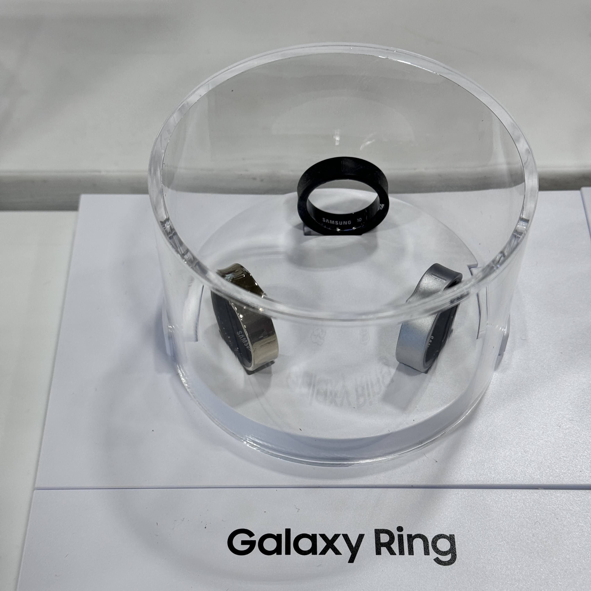
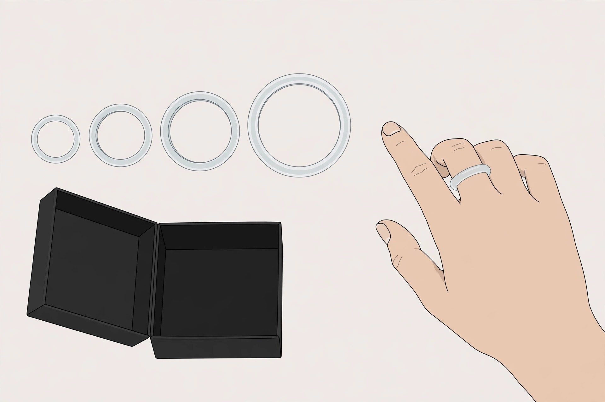
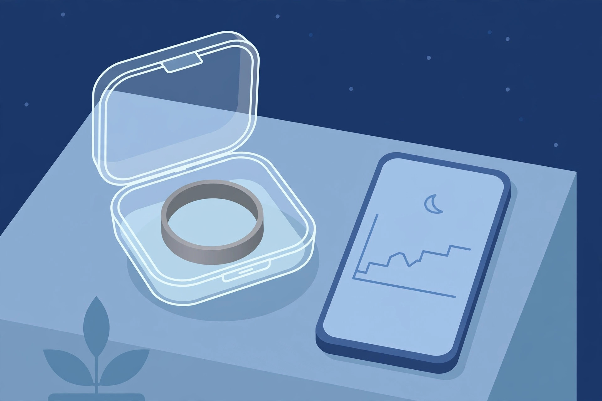

<!-- 본문 시작 -->
잠자는 동안 건강을 재는 반지 — 갤럭시 링, 사기 전에 확인할 조건

시계를 차고 자기 불편했던 사람이라면 한 번쯤 생각해봤을 것이다. 화면도 무게도 없는 반지가 잠을 재주면 얼마나 편할까. 삼성 갤럭시 링은 그 생각을 담은 반지형 건강 기록 기기다. 가격이 내린 지금, 사기 전 확인할 조건이 더 또렷해졌다.

2024년 7월 공개 행사에서 촬영된 실제 제품 사진이다. 출처: Wikimedia Commons, Miyako Fujimiya 촬영.

> 핵심 한 줄
>
> ### **구독료는 0원이지만, 쓸 수 있는 폰부터 확인해야 한다**

## 이 반지는 무엇인가

갤럭시 링은 티타늄 반지 안에 센서 세 개를 넣은 건강 기록 기기다. 삼성 공식 페이지(2026-11-13 확인)에 따르면 가속도계, 광학 생체신호 센서, 피부 온도 센서가 심박·수면·피부 온도 변화를 잰다. 화면이 없어 결과는 삼성 헬스 앱에서 본다. 수면 점수, 에너지 점수, 코골이 감지, 심박 알림, 걷기·달리기 자동 감지, 생리 주기 추적이 공식 기능이다. 단, 삼성은 이를 의료용이 아니라 일반 웰니스 기능으로 구분한다.

| 항목 | 내용 |
|---|---|
| 제품 | 삼성 갤럭시 링 (2024년 7월 공개) |
| 무게·크기 | 2.3~3.0g · 너비 7.0mm · 두께 2.6mm (크기별 차이, 제조사 표기) |
| 배터리 | 최대 6~7일 (크기별), 충전 케이스 포함 최대 약 14일 (제조사 주장) |
| 호환 | 안드로이드 11 이상, 아이폰 미지원 (2026-11-13 확인) |
| 구독료 | 없음 (삼성 헬스·갤럭시 AI 기능 기준) |
| 미국 정가 | 399.99달러 (2026-11-13 확인, 삼성 US 기준) |

## 구독료가 없다는 말의 진짜 의미

스마트 링에서 '구독료 없음'은 생각보다 큰 차이다. 오우라 링 4는 본체가 349달러부터지만 멤버십이 월 5.99달러, 연 69.99달러(미국 기준, 오우라 공식 안내, 2026-11-13 확인)이고, 자세한 수면 단계·회복 분석 같은 핵심 기능이 멤버십 뒤에 있다. 3년으로 계산하면 오우라 링 4는 349달러에 멤버십 3년분 약 210달러가 더해져 약 559달러가 된다. 갤럭시 링은 399.99달러 한 번으로 끝난다. 다만 오우라 링 5가 2026년 5월 399달러부터 출시됐다는 보도도 있어 링 4는 구세대 가격인지 따져봐야 한다.

## 사이즈 키트, 먼저 받아야 하는 이유

반지는 사이즈를 틀리면 교환도 착용감도 모두 틀어진다. 삼성은 사이즈 키트를 무료로 보내주고 샘플 반지를 24시간 이상 껴본 뒤 결정하라고 안내한다(삼성 공식 페이지, 2026-11-13 확인). 일반 반지 사이즈와 다를 수 있다는 단서도 있다. 사이즈는 출시 당시 5~13호였고 이후 2개가 추가돼 지금은 5~15호까지 고를 수 있다. 손가락은 하루에도 붓고 빠지니 샘플을 아침저녁으로 껴보는 하루가 필수다.

(일러스트) 샘플 링을 24시간 이상 껴보고 정하는 과정이 구매의 첫 단계다.

## 안드로이드 전용이라는 함정

가장 먼저 확인할 조건은 폰이다. 갤럭시 링은 안드로이드 11 이상에서만 쓸 수 있고 아이폰은 지원하지 않는다(삼성 공식 안내, 2026-11-13 확인). 한 단계 더 있다. 에너지 점수·코골이 감지·더블 핀치·분실 찾기 같은 대표 기능은 호환되는 갤럭시폰이 필요하다고 삼성 페이지 각주에 적혀 있다. 안드로이드폰이면 연결은 되지만 갤럭시폰이 아니면 광고 속 기능 일부를 못 쓸 수 있다. 아이폰 사용자라면 처음부터 선택지에 없다.

(일러스트) 충전 케이스와 함께면 최대 약 14일까지 콘센트 없이 쓸 수 있다는 게 제조사 설명이다.

## 아쉬운 점과 확인할 점

배터리는 제조사 주장과 실사용 후기가 엇갈린다. 삼성은 크기에 따라 최대 6~7일, 충전 케이스와 함께면 최대 약 14일이라고 안내한다. 독립 리뷰를 종합하면 실사용은 5~7일 안팎이 흔하다. '최대'는 보장값이 아니다. 또 2025년 배터리 부풀림 사례 1건이 보도됐고 삼성은 '극히 드문 사례'라고 밝혔다. 고장률 데이터는 없지만, 분해 전문 매체 iFixit는 배터리가 밀봉돼 교체가 사실상 불가능한 구조라고 전한다. 심전도·혈압 센서가 없는 점, 수면 무호흡 감지의 국내 적용 시점이 미확인인 점도 체크 목록에 넣어두자. 후속작 갤럭시 링 2가 2027년 초 나올 수 있다는 보도도 있어, 지금 사면 구세대를 사는 셈이 될 수 있다.

## 가격과 국내 이용

미국 공식 정가는 399.99달러다(2026-11-13 확인). 그런데 2026년 10월 말 아마존에서 324.99달러까지 내린 사례가 보도됐다(9to5Google, 2026-10-28). 정가로 사기엔 아까운 시기일 수 있다. 국내 출시 당시 가격은 499,000원이었으나 현재 국내 판매가는 미확인이다. 국내에서 사려면 공식 판매처의 현재 가격과 사이즈 키트 제공 여부를 직접 확인해야 한다.

## 나의 판단

갤럭시 링은 갤럭시폰을 쓰면서 시계 없이 수면·컨디션 흐름을 기록하고 싶은 사람에게 어울린다. 구독료가 없다는 점은 3년 기준으로 보면 확실한 장점이다. 반대로 아이폰 사용자, 운동 기록이 주 목적인 사람, 화면에서 바로 결과를 보고 싶은 사람에게는 맞지 않는다. 산다면 순서는 정해져 있다. 내 폰이 안드로이드인지, 갤럭시폰인지 확인하고, 사이즈 키트로 하루를 보내고, 할인 시기를 노리는 것이다.

## 함께 보면 좋은 글

- [찍기 전에 골라서 뽑는다 — 인스탁스 미니 Evo 2, 사기 전에 확인할 조건](https://blog.naver.com/3700708/224474362769)
  즉석 카메라를 사기 전에 필름값과 인화 방식을 먼저 따져본 글이다.
- [안경 없이 캐릭터가 책상 위에 선다 — 소니 ELF-MN1, 사기 전에 확인할 조건](https://blog.naver.com/3700708/224474361667)
  안경 없이 보는 3D 디스플레이, 사기 전에 확인할 조건을 정리한 글이다.
- [주간 AI 뉴스 모음｜매주 AI 소식, 한 번에 따라가기](https://blog.naver.com/3700708/224464427593)
  한 주간의 AI 소식을 한 번에 따라가는 AI 뉴스 모음이다.

## 출처

- [삼성 갤럭시 링 공식 제품 페이지](https://www.samsung.com/us/rings/galaxy-ring/)
- [삼성 갤럭시 링 구매 페이지 (미국 정가 확인)](https://www.samsung.com/us/rings/galaxy-ring/buy/galaxy-ring-titanium-gold-size-15-sku-sm-q515nzdaxar/)
- [오우라 링 4 공식 스토어](https://ouraring.com/store/rings/oura-ring-4)
- [오우라 구매 가이드 (가격·멤버십)](https://ouraring.com/blog/oura-ring-what-to-know-2026/)
- [9to5Google — 갤럭시 링 업데이트·75달러 할인 보도 (2026-10-28)](https://9to5google.com/2026/10/28/the-galaxy-ring-got-a-new-update-just-in-time-for-a-75-off-sale/)
- [Welltory — 갤럭시 링 정리 (가격·배터리·오우라 비교)](https://welltory.com/blog/samsung-galaxy-ring)
- [SleepyHero — 갤럭시 링 리뷰 2026](https://sleepyhero.com/sleep-trackers/samsung-galaxy-ring)
- [iFixit — 갤럭시 링 분해](https://www.ifixit.com/News/98423/samsungs-galaxy-ring-revealed?srsltid=AfmBOooTTarOLGXH50-aP5-YNJdA0e9-Bc-0YoSHonj8dMV2Ox_BU1tO)
<!-- 본문 끝 -->
