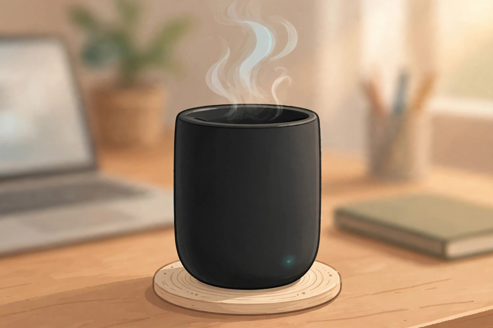
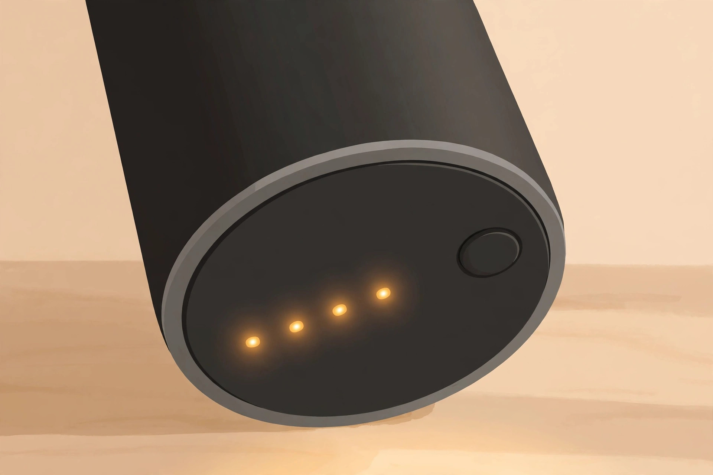
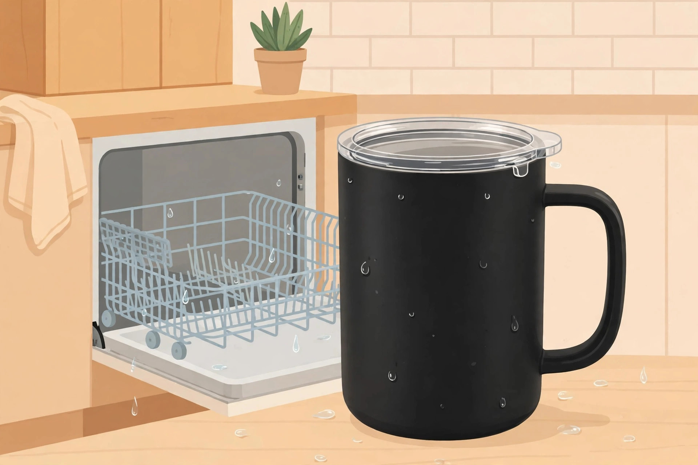

<!-- 본문 시작 -->

The Last Sip, Still at the Same Temperature — Ember Mug 3, What to Check Before Buying

Coffee poured in the morning turns into lukewarm water by the last sip if one meeting runs long. Reheating it in the microwave changes the taste. The Ember Mug 3, released by Ember in November 2026, takes aim at this old frustration. A heater and sensors inside the mug hold the temperature you set, right to the end.

On the coaster it holds its temperature all day, and the battery takes over when you carry it to another room. (Illustration)

## What is this mug?

The Ember Mug 3 is the third generation of Ember's temperature-control smart mug from the United States. It looks like an ordinary ceramic-coated mug, but a heater, precision sensors, and a battery sit in its base. According to the official product page (checked 2026-11-13), it comes in 10 oz, 14 oz, and 16 oz sizes and nine colors. You set the temperature in the app or with a button on the mug itself.

## Set the temperature on the mug itself

The biggest complaint about the previous Mug 2 was that changing the temperature meant opening the app. On the Mug 3, a button on the mug changes the temperature, and the app remains for fine adjustments in one-degree steps. According to The Verge, the button cycles through five presets between 125 and 145°F (about 52 to 63°C). LEDs on the base show the temperature setting and the battery level while charging. According to the official page, you can use it right away without the app.

The LEDs on the base show the temperature setting and the battery level while charging. You can check the status at a glance without opening the app. (Illustration)

## Three hours with the lid on, 80 minutes without

Battery life depends heavily on the lid. According to the official specifications, the 14 oz model lasts over three hours with the lid on and 80 minutes with the lid off. On the charging coaster it holds its temperature all day. The lid is included in the box, and Ember values it at $14.95 on its own. Auto sleep is built in too, shutting the heater down when the mug is empty.

## It goes in the dishwasher

The Mug 2 and earlier models were hand wash only. The Mug 3 can go on the top rack of a dishwasher. It must be fully dry before charging, and the charging coaster and cable must stay out of the dishwasher. Some buyer reviews on the official page, however, report a unit failing after dishwasher use, so it is worth remembering that this is a new feature.

> Key line
>
> ### **The last sip, at exactly the temperature you set**

## Drawbacks and things to check

The first thing to check is that it does nothing for cold drinks. The official FAQ states that the Mug 3 is made to maintain hot drinks and will not keep iced coffee cold. Buyer reviews on the official page (rated 4.5/5, 175 reviews) mention slow charging and a battery that drains quickly. Some reviews also say it is heavier than an ordinary mug. A BBC Science Focus review of the Mug 2 also noted that the last sip can feel excessively hot.

| Item | Details |
|---|---|
| Product | Ember Mug 3 |
| Capacity | 10 oz, 14 oz, 16 oz (14 oz is 414 ml) |
| Temperature control | Button on the mug + Ember app |
| Battery | Over 3 hours with the lid, 80 minutes without (14 oz); all day on the coaster |
| Cleaning | Top rack of a dishwasher (charge only when fully dry); coaster and cable excluded |
| Price | 14 oz list price $149.95, on sale for $99.99 as of 2026-11-11 |

The included sliding lid stretches battery life from 80 minutes to over three hours. After the dishwasher, let it dry completely before charging. (Illustration)

## Price and availability in Korea

The list price for the 14 oz model is $149.95 at the official US store. As of November 11, 2026, it was selling for $99.99 at the official store and on Amazon (about 134,000 KRW at roughly 1,335 KRW per dollar on 2026-11-13, before shipping and customs). The 10 oz model is $89.99 and the 16 oz model is $109.99. Whether it is officially sold in Korea has not been confirmed. The US official store offers free shipping, but whether that applies to Korea is unconfirmed, so buying from Korea would mean ordering from overseas. The warranty is one year for the mug and lifetime for the charging coaster.

## My take

This mug suits people who drink coffee slowly and people whose coffee goes cold between meetings. The battery that lasts three hours with the lid on and dishwasher-safe cleaning fix exactly what the previous generation got wrong. But if you finish coffee quickly, live on iced coffee, or hesitate to spend over 100,000 KRW on a mug, an ordinary mug and a thermos will do. Before buying, check your own coffee habits first. If you nurse one cup for over an hour, the sale price of $99.99 is more persuasive than the previous generation's list price.

## Worth reading next

- [A Touchscreen on a USB Hub — Dockcase 7-in-1, What to Check Before Buying](https://aitechnotesen.wordpress.com/2026/11/08/a-touchscreen-on-a-usb-hub-dockcase-7in1-what-to-check-before-buying/) — A look at what a USB hub with a touchscreen is for.
- [Fold It Shut and the Lens Closes — OBSBOT Meet Flip, What to Check Before Buying](https://aitechnotesen.wordpress.com/2026/11/08/fold-it-shut-and-the-lens-closes-obsbot-meet-flip-what-to-check-before-buying/) — A webcam whose lens closes when you fold it shut.
- [A Keyboard Where Lifting a Typewriter Lever Presses Enter — Epomaker Glyph, What to Check Before Buying](https://aitechnotesen.wordpress.com/2026/11/03/a-keyboard-where-lifting-a-typewriter-lever-presses-enter-epomaker-glyph-what-to-check-before-buying/) — A keyboard that brings a typewriter lever back to the desk.

## Sources

- [Ember Mug 3 official product page](https://ember.com/products/ember-mug-3) — Specifications, price, FAQ, and buyer reviews (checked 2026-11-13)
- [The Gadgeteer on the Ember Mug 3](https://the-gadgeteer.com/2026/11/10/the-self-heating-mug-that-finally-goes-in-the-dishwasher-is-99-99-a-third-off-list/) — Price and prices by color and size (published 2026-11-10)
- [Ember Mug 2 review, BBC Science Focus](https://www.sciencefocus.com/reviews/ember-mug-2-review) — Hands-on experience and limits of the previous generation (published 2022, updated 2026-06-15)
- [USD-KRW exchange rate, Finnhub](https://finnhub.io/?q=%22USD%2FKRW%22) — About 1,335 KRW per dollar as of 2026-11-12

<!-- 본문 끝 -->
