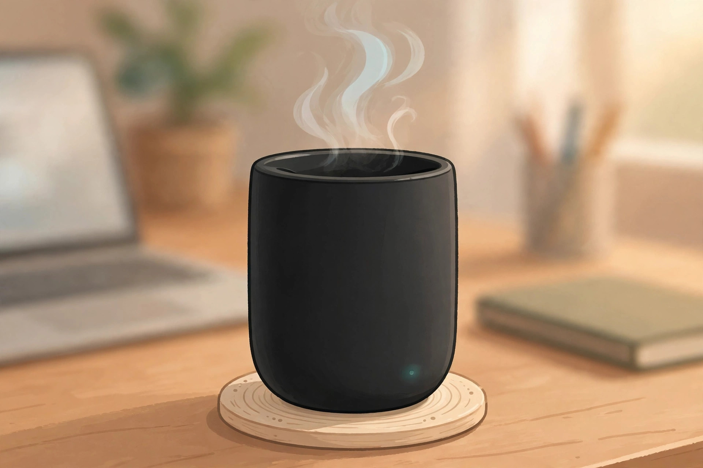
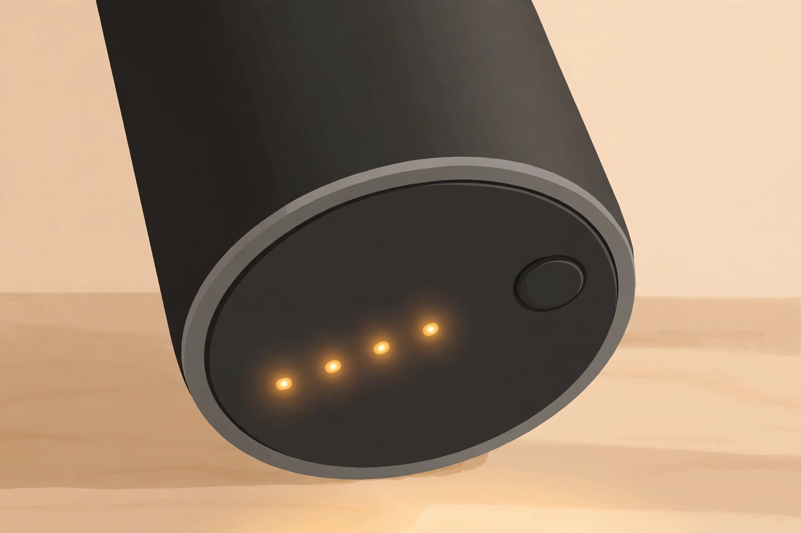
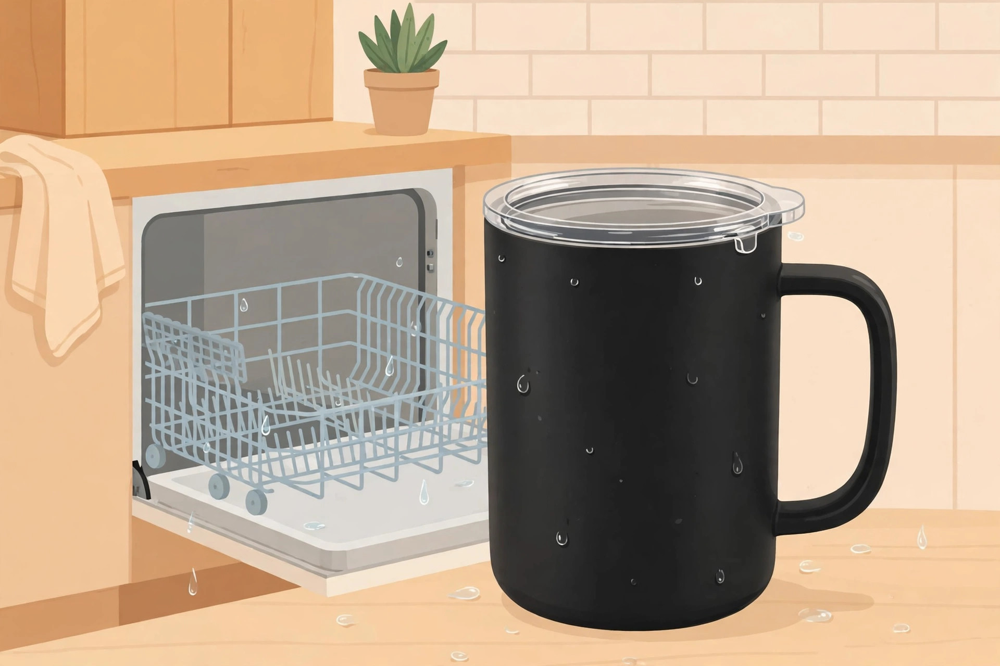

<!-- 본문 시작 -->

Ember Mug 3｜끝까지 같은 온도, 99.99달러 할인

> 아침에 내린 커피, 한 시간만 지나면 마지막은 미지근해진다.
> **뚜껑을 닫으면 3시간, 정가보다 약 50달러 싸다.**
> 아이스커피가 주식이면 사지 말고, 커피를 천천히 마시는 사람만 따져보자.

아침에 내린 커피가 회의 하나만 길어지면 마지막 한 모금은 미지근한 물이 된다. 전자레인지에 데우면 맛이 달라진다. 엠버가 2026년 11월에 내놓은 머그 3은 이 오래된 불만을 겨냥한 제품이다. 이 글은 엠버 공식 자료와 독립 리뷰를 모아 정리했다.

머그 안의 히터와 센서가 **정한 온도를 끝까지 유지해 준다**. 코스터 위에서는 종일, 들고 가도 배터리가 이어받는다. 가격이 내린 지금, 사기 전에 확인할 조건이 더 또렷해졌다.

코스터 위에서는 종일, 떼어 들고 가도 배터리가 온도를 이어받는다. (일러스트)

## 이 머그는 무엇인가

겉은 평범한 세라믹 코팅 머그지만, 바닥에 히터와 정밀 센서, 배터리가 들어 있다. 엠버 머그 3은 미국 엠버의 온도 유지 스마트 머그 3세대다. 크기는 10·14·16온스, 색상은 9가지다. **온도는 앱이나 머그 본체 버튼으로 정한다.**

| 항목 | 내용 |
|---|---|
| 제품 | Ember Mug 3 (엠버 머그 3, 2026년 11월 출시) |
| 용량 | 10·14·16온스 (14온스 414ml) |
| 온도 조절 | 머그 본체 버튼 + Ember 앱 |
| 배터리 | 뚜껑 사용 시 3시간 이상, 미사용 시 80분(14온스); 코스터 위 종일 |
| 세척 | 식기세척기 상단 랙 가능(완전 건조 후 충전); 코스터·케이블 제외 |
| 가격 | 14온스 정가 149.95달러, 2026-11-11 기준 99.99달러 |

## 버튼 하나로 온도를 바꾸면 뭐가 달라지나?

앱을 켜지 않고 온도를 바꿀 수 있다. 이전 세대 머그 2의 가장 큰 불만은 온도 하나 바꾸려고 앱을 켜야 했다는 점이었다. 머그 3은 본체 버튼으로 온도를 바꾸고, **앱은 1도 단위 미세 조정용으로 남았다.**

더 버지 보도에 따르면 버튼은 다섯 단계를 순환한다. 범위는 125~145°F(약 52~63°C)다. 밑면 LED가 설정 온도와 충전 중 배터리 잔량을 표시한다. 앱 없이도 바로 쓸 수 있다.

밑면 LED는 설정 온도와 충전 중 배터리 잔량을 보여준다. 앱 없이도 상태를 눈으로 확인할 수 있다. (일러스트)

## 뚜껑을 닫으면 3시간, 열면 80분

뚜껑이 배터리 시간을 정한다. 14온스 기준 공식 사양은 뚜껑을 닫으면 3시간 이상, 뚜껑 없이 마시면 80분이다. **충전 코스터 위에서는 종일 온도를 유지한다.** 뚜껑은 기본 포함이며, 엠버는 단품 가치를 14.95달러로 안내한다. 비어 있으면 자동으로 잠드는 오토 슬립도 들어 있다.

## 식기세척기에 넣는다

식기세척기 상단 랙에 넣을 수 있다. 머그 2까지는 손세척만 가능했다. 단, **완전히 말린 뒤에 충전해야 하고**, 충전 코스터와 케이블은 식기세척기에 넣으면 안 된다. 다만 공식 페이지 구매자 후기 중에는 식기세척기 사용 뒤 고장 사례도 있어, 새 기능이라는 점은 감안할 필요가 있다.

> 핵심 한 줄
>
> ### **마지막 한 모금까지, 처음 정한 그 온도 그대로**

## 아이스커피도 차갑게 유지될까?

아니다. 차가운 음료에는 소용없다. 공식 FAQ는 머그 3이 뜨거운 음료를 유지하는 제품이며, 아이스커피를 차갑게 유지하지는 않는다고 밝힌다.

공식 페이지 구매자 후기(평점 4.5/5, 175건)에는 **충전이 느리다, 배터리가 빨리 닳는다**는 지적이 있다. 무게도 일반 머그보다 무겁다는 후기가 있다. BBC 사이언스 포커스의 머그 2 리뷰도 **마지막 한 모금이 지나치게 뜨겁다**고 지적했다.

| 대상 | 핵심 값 | 고를 때 |
|---|---|---|
| Ember Mug 3 | 99.99달러(2026-11-11 기준), 뚜껑 닫으면 3시간, 식기세척기 가능 | 커피를 천천히 마시고 온도를 끝까지 유지하고 싶을 때 |
| Ember Mug 2 | 앱으로만 온도 조절, 손세척만 가능 | 중고로 싸게 구할 때만 |
| 일반 머그 | 온도 유지 기능 없음 | 커피를 빨리 마시거나 아이스커피가 주식일 때 |

기본 포함된 슬라이딩 뚜껑은 배터리 시간을 80분에서 3시간 이상으로 늘려준다. 식기세척기 뒤에는 완전히 말린 뒤 충전한다. (일러스트)

## 가격과 국내 이용

미국 공식 스토어 기준 14온스 정가는 149.95달러다. 2026년 11월 11일 기준 공식 스토어와 아마존에서 **99.99달러에 판매 중**이었다. 2026-11-13 기준 1달러 약 1,335원 단순 환산으로 약 13만 4천 원이며, 배송비·관세는 별도다.

10온스는 89.99달러, 16온스는 109.99달러다. 국내 정식 판매 여부는 확인하지 못했다. 미국 공식 스토어의 무료 배송이 한국에도 적용되는지는 미확인이라, 국내 구매는 해외 직구가 전제가 된다. 보증은 머그 1년, 충전 코스터는 평생 보증이다.

## 나의 판단

이 머그는 커피를 천천히 마시는 사람, 회의 사이에 커피가 식는 사람에게 어울린다. **뚜껑을 닫고 3시간을 버티는 배터리와 식기세척기 세척**은 전 세대의 아쉬움을 정확히 겨냥한 개선이다. 반대로 커피를 빨리 마시거나, 아이스커피가 주식이거나, 머그에 10만 원 넘게 쓰기 망설여진다면 일반 머그와 보온병 조합이 충분하다.

- 한 잔을 한 시간 넘게 붙들고 있는지 확인한다
- 아이스커피가 주식이면 선택지에서 제외한다
- 99.99달러 할인가와 국내 직구 배송비·관세를 함께 따진다

한 잔을 한 시간 넘게 붙들고 있는 사람이라면, 할인가 99.99달러는 전 세대 정가보다 설득력이 있다.

## 함께 읽으면 좋은 글

[후지필름 X half｜하프프레임 디지털 카메라, 79만 원](https://blog.naver.com/3700708/224480043492)

하프프레임의 재미를 79만 원에 담았는지, 사기 전에 확인할 조건을 정리한 글이다.

[사운드코어 Sleep A30｜코골이 가리는 수면 이어버드, 3가지 조건](https://blog.naver.com/3700708/224479995584)

코골이를 가리는 수면 이어버드, 사기 전에 확인할 3가지 조건을 정리한 글이다.

[GPT-6 사이버｜가장 강력한 AI가 공개되지 않는 이유](https://blog.naver.com/3700708/224477518377)

가장 강력한 AI가 왜 공개되지 않는지, AI 뉴스로 정리한 글이다.

## 출처

- [Ember Mug 3 공식 제품 페이지](https://ember.com/products/ember-mug-3) — 사양·가격·FAQ·구매자 후기 (2026-11-13 확인)
- [The Gadgeteer, Ember Mug 3 소개](https://the-gadgeteer.com/2026/11/10/the-self-heating-mug-that-finally-goes-in-the-dishwasher-is-99-99-a-third-off-list/) — 가격·색상·크기별 가격 (2026-11-10 발행)
- [Ember Mug 2 리뷰, BBC Science Focus](https://www.sciencefocus.com/reviews/ember-mug-2-review) — 전 세대 사용 경험·한계 (2022년 발행, 2026-06-15 업데이트)
- [달러-원 환율, Finnhub](https://finnhub.io/?q=%22USD%2FKRW%22) — 2026-11-12 기준 1달러 약 1,335원

<!-- 본문 끝 -->
