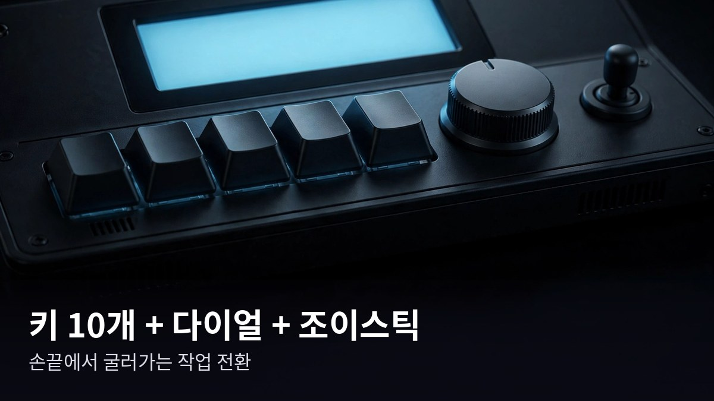

<!-- 본문 시작 -->
조이스틱이 달린 매크로 패드 — 한국 스타트업의 ComboX

매일 같은 작업을 반복하다 보면 손가락이 먼저 지칩니다.
복사해서 붙여넣고, 앱을 오가고, 같은 단축키를 열 번 누르는 일.
오늘 소개할 제품은 이런 반복 작업을 책상 위 작은 기계에 맡기자는 아이디어에서 출발했습니다.
이 글은 자료를 바탕으로 정리한 소개 글입니다.

## 이 기계는 무엇인가요

ComboX는 한국 스타트업 Electrocookie가 만든 매크로 콘솔입니다.
키보드처럼 생겼지만 키보드가 아닙니다.
10개의 기계식 키, 로터리 다이얼, 조이스틱, 작은 LCD 화면을 한 몸에 담은 데스크용 컨트롤러입니다.
현재 킥스타터에서 펀딩이 진행 중이며, 2026년 12월 배송 예정이라고 합니다.

> **핵심 한 줄: 자주 쓰는 작업을 물리 버튼 하나로 묶어주는 책상 위 조종간입니다.**

## 왜 재미있나요

**첫째, 조이스틱으로 가상 데스크톱을 오갑니다.**
윈도우의 가상 데스크톱이나 macOS의 스페이스를 조이스틱으로 넘나들 수 있습니다.
키보드 단축키를 외울 필요 없이 손가락 하나로 화면을 전환하는 방식입니다.
여러 작업을 오가는 사람에게는 손에 익으면 편해 보이는 지점입니다.

**둘째, 화면 캡처를 AI로 바로 연결합니다.**
제조사에 따르면 'AI Link' 기능은 화면에서 캡처한 내용을 저장된 프롬프트와 함께 AI 서비스로 바로 보낼 수 있다고 합니다.
캡처하고, AI 서비스를 열고, 붙여넣고, 프롬프트를 입력하는 과정을 줄여주는 것이 목표입니다.
실제로 얼마나 매끄럽게 동작하는지는 아직 독립 리뷰가 없어 확인하지 못했습니다.

**셋째, 앱마다 다른 배치를 7개 레이어에 저장합니다.**
영상 편집용, 스트리밍용, 문서 작업용처럼 용도별로 키 설정을 나눠 둘 수 있습니다.
키 스위치는 공구 없이 교체할 수 있는 핫스왑 방식이라고 합니다.

## 아쉬운 점도 있습니다

펀딩 제품이라는 점을 먼저 짚어야 합니다.
킥스타터 펀딩이라 배송 지연 가능성을 염두에 두는 것이 좋습니다.
정확한 가격도 보도자료에는 공개되지 않았습니다.
얼리버드 가격이 적용된다고만 안내되어 있어, 실제 금액은 킥스타터 캠페인 페이지에서 직접 확인해야 합니다. (2026년 10월 16일 확인)
전용 소프트웨어 설정에 익숙해지는 시간도 필요해 보입니다.

## 가격과 국내 이용

현재 킥스타터에서 펀딩이 진행 중이며 배송 예정 시기는 2026년 12월입니다.
한국 기업 제품이지만 킥스타터 펀딩이라 한국 배송 조건과 배송비는 캠페인 페이지에서 별도 확인이 필요합니다.
국내 정식 출시 계획은 확인하지 못했습니다.

| 항목 | 내용 |
|---|---|
| 제품명 | ComboX |
| 제조사 | Electrocookie (한국) |
| 구성 | 기계식 키 10개, 로터리 다이얼, 조이스틱, LCD 화면 |
| 주요 기능 | AI Link, 가상 데스크톱 전환, 7개 레이어 |
| 판매 단계 | 킥스타터 펀딩 중 |
| 배송 예정 | 2026년 12월 |
| 가격 | 미확인 (얼리버드 적용, 캠페인 페이지 확인 필요) |

## 에디터의 판단

영상 편집, 스트리밍, 여러 AI 도구를 오가는 작업을 하는 사람에게 어울려 보입니다.
특히 프리미어 프로, 애프터이펙트, OBS 연동을 내세우는 만큼 크리에이터가 주 타깃으로 보입니다.
반면 단축키 몇 개 정도만 쓰는 사람에게는 일반 매크로 패드로도 충분할 수 있습니다.
펀딩 리스크를 감수할 만큼 이 기계의 손맛이 끌리는지가 판단 기준이 될 것 같습니다.

## 출처

- Electrocookie 공식 사이트: https://www.combo-x.io/
- 킥스타터 캠페인 (2026년 10월 13일 론칭, 보도자료 기준)
<!-- 본문 끝 -->

## Working notes (excluded from upload)

- Restoration (batch naver-refresh-20261021-v1): Korean original restored verbatim from the local original manuscript ~/workspace/goals/ai/hidden_files/drafts/2026-10-16/combox_manuscript.md — no polishing, no fact changes, no new content. Image markers @@HERO@@/@@IMG1@@/@@IMG2@@/@@IMG3@@ replaced with the 4 original images in manuscript order (the published Naver version only carried 3 images and left the @@IMG3@@ marker in the body; the restored package includes the 4th original image at its manuscript position).
- Images (AI-generated illustrations, self-made, usage rights: own):
  - images/01-hero.jpg ← combox_hero.jpg / 기계식 키 10개·로터리 다이얼·조이스틱·LCD를 한 몸에 담은 매크로 콘솔 (일러스트)
  - images/02-controls.jpg ← combox_controls.jpg / 키 스위치는 공구 없이 교체할 수 있는 핫스왑 방식이다 (일러스트)
  - images/03-ailink.jpg ← combox_ailink.jpg / AI Link는 캡처한 화면을 저장된 프롬프트와 함께 AI 서비스로 바로 보낸다 (일러스트)
  - images/04-usage.jpg ← combox_usage.jpg / 앱마다 다른 키 배치를 7개 레이어에 나눠 저장한다 (일러스트)
- Naver original already public at source_url; targets exclude naver-ko by design.
