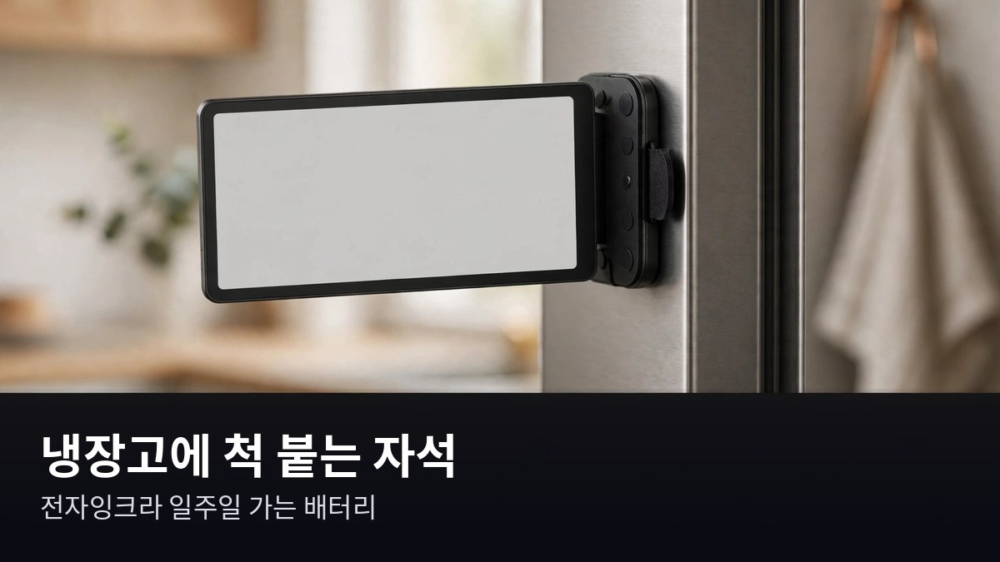

<!-- 본문 시작 -->
A magnetic memo board that writes down what you say — Seeed Studio reTerminal Sticky

You've seen sticky notes on a fridge door.
Short notes like "buy milk" or "call me at 6 pm."
The product introduced today turns that sticky note into e-ink.
It's a magnetic memo board that writes down what you say.
This introduction is based on published materials.

## What is this device?

The reTerminal Sticky is an e-ink memo device made by Seeed Studio.
It has a 3.97-inch e-ink touch screen and a magnet, so it sticks right onto a fridge or metal surface.
Press the button and speak, and AI converts your voice to text and shows it on the screen.
You can also send memos remotely or display widgets like the weather through the smartphone app (Seeedash).

> One line
>
> **A magnetic e-ink memo board for the fridge that writes down what you say.**

## Why it's fun

**First, speak and it becomes a memo.**
Press the AI voice button on the device and speak, and a few seconds later it appears as text on the screen.
According to an XDA review, the actual feel of using it is quite smooth.
The advantage is that you don't have to type out messages for your family.

**Second, it's magnetic, so it sticks anywhere.**
The built-in magnet attaches it directly to a fridge, and on non-metal walls you can use the included magnetic ring.
Because it's e-ink, the battery lasts about 7 days even with the screen always on.
Like a paper memo that needs no power, it's always visible.

**Third, it transforms with open-source firmware.**
It uses an ESP32 chip, so loading open-source firmware like CrossPoint turns it into a mini e-book reader.
It can also work as a real-time information dashboard with TRMNL, or connect to Home Assistant through ESPHome.
It's built so you can use it lightly as a family memo board, or deeply as a DIY platform.

## There are downsides too

There's no front light, so it's hard to see in dark places.
The screen is glossy, so there can be reflections under bright lighting.
The built-in storage is small at 32MB, and you need to add a microSD card separately.
The currently supported languages are only English and Simplified Chinese, so Korean voice recognition could not be confirmed.
Direct shipping conditions to Korea also need to be checked separately on the official page.

## Price and availability in Korea

| Item | Detail |
| --- | --- |
| Product | reTerminal Sticky |
| Maker | Seeed Studio |
| Screen | 3.97-inch e-ink touch (800×480) |
| Battery | 750mAh, about 7 days |
| Weight | 70g |
| Price | $49.90 (verified October 16, 2026) |
| Availability in Korea | Not confirmed (mention of a planned official store and AliExpress listing) |

## Editor's take

It looks well suited to homes that want to share memos with family, especially households that often use fridge memos.
For people interested in DIY or open source, the fun of swapping the firmware could be a big draw.
On the other hand, if Korean voice support is essential, it's too early for now.
It's worth recommending to anyone who wants to try e-ink + voice + magnets all at once for around $50.

## Sources

- Seeed Studio reTerminal Sticky official page
- Reviews by Good e-Reader, Liliputing, CNX Software, and XDA Developers (July–August 2026)
<!-- 본문 끝 -->

## Working notes (excluded from upload)

- English edition for batch naver-refresh-20261021-v1: faithful translation of the restored Korean original (post.md in this folder, restored verbatim from the local original manuscript). No polishing, no fact changes, no new content. Quote format follows the Korean original (label + bold line, no ###).
- Sources: Seeed Studio reTerminal Sticky official page / Good e-Reader, Liliputing, CNX Software, XDA Developers reviews (July–August 2026). Price verified October 16, 2026.
- 3 images (AI-generated illustrations, self-made, usage rights: own), same positions as the Korean edition:
  - images/01-hero.jpg / 3.97-inch e-ink — like paper, it doesn't shine, so it's easy on the eyes (illustration)
  - images/02-voice.jpg / One press of the AI voice button and the memo is done — no typing needed (illustration)
  - images/03-magnet.jpg / 7.3mm thick, 70g — lighter than a stack of sticky notes (illustration)
- Fact check: battery about 7 days (maker figure as reported in the Korean original), Korean voice recognition not confirmed, supported languages English and Simplified Chinese only, direct shipping to Korea not confirmed.
- Target: English WordPress/Blogger (multi-channel program). English edition content_revision: 1 — confirm against check_distribution before first submit.
- Additional requests: none
