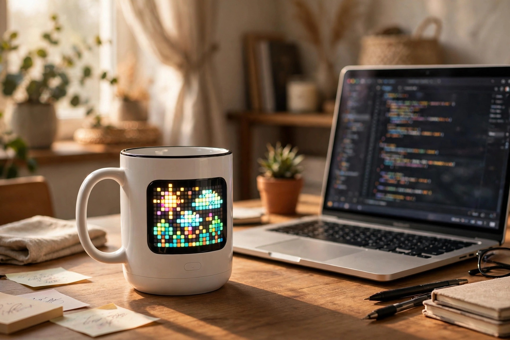
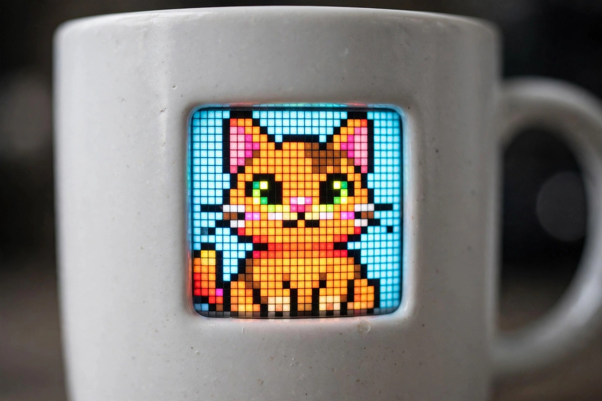
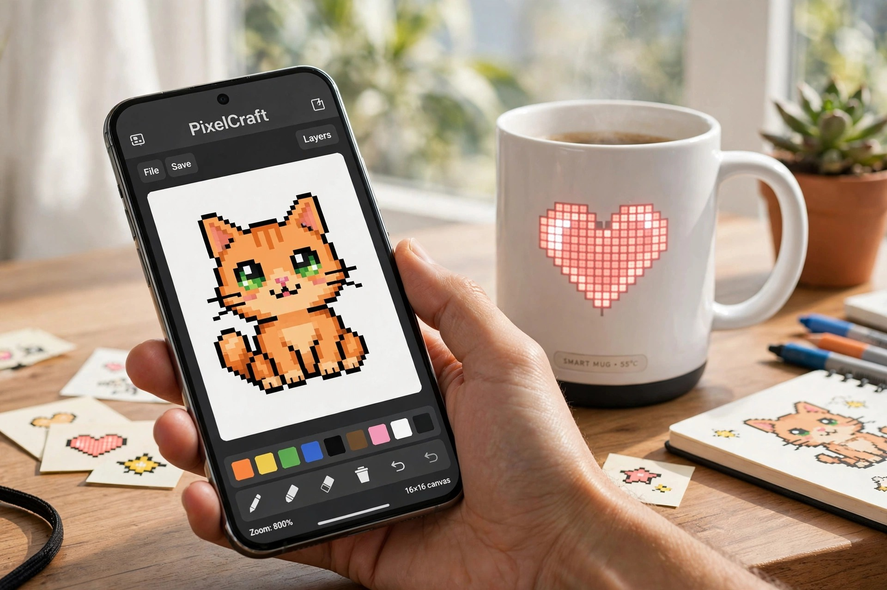

<!-- 본문 시작 -->
화면에 그림이 뜨는 머그컵 — PixelMug P1

아침에 커피를 따르면서 머그컵을 본 적 있으시죠.
그 컵에 작은 화면이 들어 있어서 그림이 움직인다면 어떨까요.
오늘 소개할 제품은 도자기 몸체에 픽셀 디스플레이를 숨긴 스마트 머그컵입니다.
이 글은 자료를 바탕으로 정리한 소개 글입니다.

## 이 컵은 무엇인가요

PixelMug P1은 도자기(포슬린) 몸체에 4.83인치 풀컬러 픽셀 LED 화면을 넣은 머그컵입니다.
화면은 가로 32×세로 16 픽셀로, 도자기 표면 아래에 숨어 있다가 켜지면 빛납니다.
전용 앱(BUBBLE)으로 직접 그린 픽셀아트나 애니메이션을 올릴 수 있고, AI가 사진을 픽셀 초상화로 바꿔주기도 합니다.
온도 센서가 들어 있어 음료 온도를 화면에 실시간으로 보여줍니다.

> 핵심 한 줄
>
> ### **도자기에 화면을 숨긴, 그림이 움직이는 머그컵입니다.**

## 왜 재미있나요

**첫째, 컵이 메시지 보드가 됩니다.**
앱에서 문구를 입력하면 화면에 흘러가는 자막처럼 표시됩니다.
"회의 중", "커피 한 잔 어때요" 같은 문구를 띄워두는 식입니다.
QR코드를 화면에 띄울 수도 있어 명함 대용으로도 쓸 수 있습니다.

**둘째, AI가 그림을 그려줍니다.**
셀카를 올리면 몇 초 만에 8비트 픽셀 초상화로 바꿔줍니다.
프롬프트를 입력하면 AI가 픽셀아트를 새로 생성합니다.
그림을 못 그려도 매일 다른 디자인의 컵을 쓸 수 있는 구조입니다.

**셋째, 컵인데 시계이자 날씨 알리미입니다.**
여러 스타일의 픽셀 시계를 띄울 수 있고, 날씨 정보도 표시됩니다.
미니게임(떨어지는 공, 슬롯머신 등)이 내장되어 있어 쉬는 시간에 즐길 수 있습니다.
자이로스코프가 있어 기울이면 반응하는 인터랙션도 있습니다.

## 아쉬운 점도 있습니다

배터리가 600mAh로, 연속 사용 시 약 2시간 정도만 갑니다.
하루 종일 화면을 켜두는 용도보다는 짧게 즐기는 데 맞습니다.
용량이 175ml로 일반 머그컵보다 작아 에스프레소나 작은 음료에 어울립니다.
전자레인지와 식기세척기는 사용할 수 없고 손세탁만 가능합니다.
무게도 350g으로 빈 컵치고는 묵직한 편입니다.

## 가격과 국내 이용

| 항목 | 내용 |
|---|---|
| 제품명 | PixelMug P1 |
| 제조사 | PixelMug (Freeingbag) |
| 화면 | 4.83인치 풀컬러 픽셀 LED (32×16) |
| 배터리 | 600mAh, 약 2시간 (USB-C·무선충전) |
| 방수 | IPX7 (손세탁 가능) |
| 가격 | $109.65 (정가 $129, 2026년 10월 17일 확인) |
| 국내 이용 | 미확인 (공식 사이트 해외 직구) |

## 에디터의 판단

책상 위에 두고 싶은 사람, 특히 데스크테리어에 관심 있는 사람에게 어울립니다.
선물용으로도 재미있어 보입니다. 매일 다른 그림의 컵을 쓰는 경험은 분명 새롭습니다.
다만 실용적인 머그컵을 찾는 사람에게는 배터리와 용량이 아쉬울 수 있습니다.
110달러 정도에 "재미"를 사는 거라고 생각하면 납득이 갑니다.

## 출처

- PixelMug 공식 사이트 (pixelmug.com)
- GadgetGram, 513.toys, GadgetUser 리뷰
<!-- 본문 끝 -->

## Working notes (excluded from upload)

- Restoration (batch naver-refresh-20261021-v1): Korean original restored verbatim from the local original manuscript ~/workspace/goals/ai/hidden_files/drafts/2026-10-17/pixelmug_manuscript.md — no polishing, no fact changes, no new content. Image markers @@HERO@@/@@IMG1@@/@@IMG2@@ replaced with the original images in manuscript order.
- Images (AI-generated illustrations, self-made, usage rights: own):
  - images/01-hero.jpg ← pixelmug_hero.jpg / 도자기 표면 아래 숨은 4.83인치 픽셀 LED 화면 — 켜지면 빛난다 (일러스트)
  - images/02-screen.jpg ← pixelmug_screen.jpg / 화면은 가로 32×세로 16 픽셀, 온도 센서가 음료 온도를 실시간으로 보여준다 (일러스트)
  - images/03-app.jpg ← pixelmug_app.jpg / 전용 앱 BUBBLE로 픽셀아트를 올리고 AI 초상화로 바꿀 수 있다 (일러스트)
- Naver original already public at source_url; targets exclude naver-ko by design.
