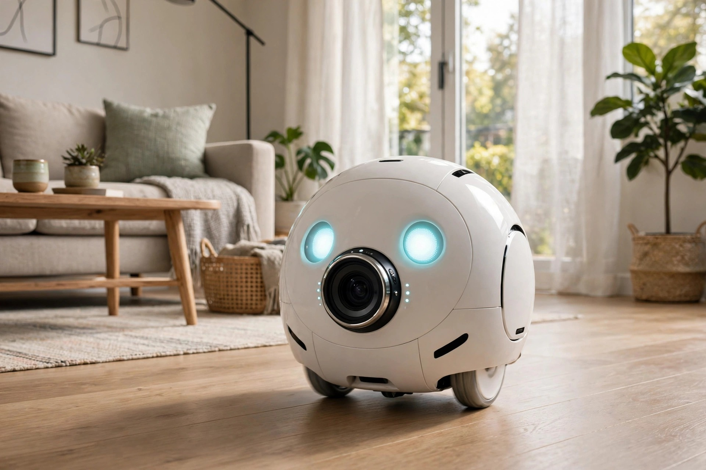
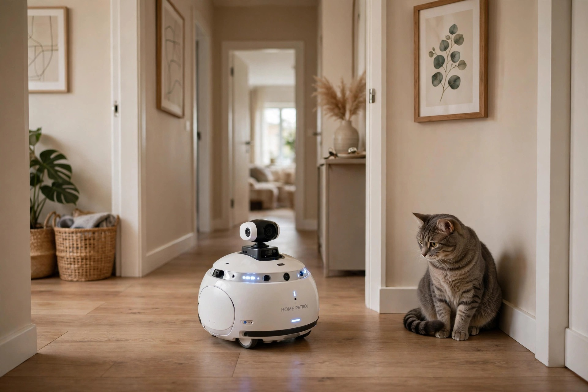
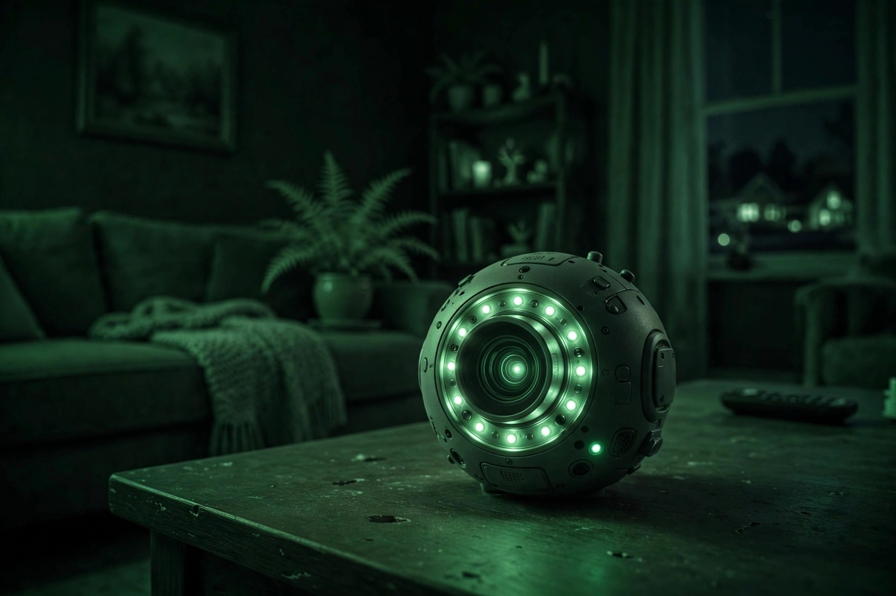

<!-- 본문 시작 -->
A camera that roams your home — the Enabot EBO SE

Have you ever wondered what your pet is up to while you're out?
A fixed camera can't see anything once its view is blocked.
Today's product is a moving camera that drives around your home filming as it goes.
This introduction is based on published materials.

## What is this robot?

The Enabot EBO SE is a ball-shaped mobile home camera on wheels.
With a 1080p Full HD camera and infrared night vision, it can see dark rooms too.
You steer it around your home with a smartphone app and watch the live video.
Two-way audio means you can talk to family or pets on the other side of the screen.

> One line
>
> ### **A roaming eye that removes the blind spots of fixed cameras.**

## Why it's fun

**First, it sees under beds too.**
If your pet hides behind the sofa or under the bed, a fixed camera is useless.
With the EBO SE you can drive over and check for yourself.
It has sensors that detect obstacles and stop it, and if it tips over it gets back up on its own, like a roly-poly toy.

**Second, it patrols on its own.**
Turn on auto patrol mode and it goes around your home at set times.
It sends a push notification when it detects movement.
When the battery runs low, it returns to its charging dock by itself.

**Third, there is no subscription fee.**
Video and photos are stored on an SD card in the body itself (the official store spec supports up to 256GB, checked October 24, 2026 — early listings said '16GB included, up to 128GB', so check the bundle when buying).
It's built so you don't have to buy a cloud plan.
In the app you can add music and subtitles to video and share it straight to social media.

## The catch

Features like AI monitoring and a laser pointer are not on this SE (official support FAQ, checked October 24, 2026 — they belong to the higher-end EBO Air and the newer EBO SE 2).
The SE is the standard model, so you either steer it yourself or use scheduled patrols. The newer SE 2 differs — 2K camera, laser, Wi-Fi 6 — so don't confuse it with the SE covered here.
It has no waterproofing (per the official spec) and is made for flat indoor floors only; the official spec lets it cross only about 5–6 mm, so it struggles with thresholds and thick carpets.
Windows and Mac aren't supported — it works only through the smartphone app (iOS and Android).
The battery lasts 4 to 7 hours, so it isn't meant to stay on all day.

## Price and availability in Korea

| Item | Detail |
| --- | --- |
| Product | Enabot EBO SE |
| Maker | Enabot |
| Camera | 1080p Full HD, infrared night vision |
| Battery | 2500mAh, 4–7 hours (automatic charging dock) |
| Weight · size | 280g, 95×89.2×95mm |
| Price | Official store $139 (checked October 24, 2026; varies by seller) |
| Availability in Korea | Not confirmed (the official store advertises worldwide shipping and a 1-year warranty, but official Korean distribution and service terms are not confirmed; checked October 24, 2026) |

## Editor's take

For a home with a pet, this looks like the most useful option.
For anyone who wants to check on their pet while out, the deciding factor is that it can drive into a fixed camera's blind spots.
It also looks decent for home security in a single-person or dual-income household.
Just note that a multi-level home or one with many thresholds will limit how it moves, so check your layout first.

## Sources

- Enabot official support page https://www.enabot.com/support/ebo-se (checked October 24, 2026 — SE vs Air feature FAQ)
- Enabot official store https://www.enabot.com/products/ebo-se (checked October 24, 2026 — $139 price, 1080p resolution, SD up to 256GB, no waterproofing)
- Enabot official EBO SE 2 page https://www.enabot.com/home-robot/ebo-se-2 (model distinction, checked October 24, 2026)
- Amazon, Wellbots, Altituded PH product pages
- Furrenz Pet Shop review
<!-- 본문 끝 -->

## Working notes (excluded from upload)

- English edition (batch naver-refresh-20261021-v1): faithful translation of the restored Korean edition (post.md, restored verbatim from the local original manuscript ~/workspace/goals/ai/hidden_files/drafts/2026-10-17/ebo_manuscript.md) — no facts added or changed, manufacturer claims and unconfirmed items kept as in the Korean edition.
- Sources: Enabot official site / Amazon, Wellbots, Altituded PH product pages / Furrenz Pet Shop review — same sources as the Korean edition. Price about $140–$209 (varies by seller, verified October 17, 2026); availability in Korea not confirmed.
- Images (AI-generated illustrations, self-made, usage rights: own), same positions as the Korean edition:
  - images/01-hero.jpg / 95×89.2×95mm, 280g — a ball-shaped body holding a 1080p camera (illustration)
  - images/02-patrol.jpg / It stops with obstacle-detection sensors, and if it tips over it gets back up on its own (illustration)
  - images/03-night.jpg / Infrared night vision lets you see dark rooms too (illustration)
- Fact check: battery 2500mAh, 4–7 hours; SD up to 256GB per the official store spec (corrected 2026-10-24, revision 2); AI monitoring and laser pointer belong to EBO Air / EBO SE 2, not the SE — all as stated in the Korean edition.
- Naver original already public at source_url; targets are wordpress-en and blogger-en only.

- Correction (2026-10-24, revision 2): SD maximum corrected to the official store spec (256GB) with the early-listing difference noted. AI/laser features attributed specifically to EBO Air and EBO SE 2 and separated from the SE. Threshold height (5–6 mm), price (official store $139) and Korea terms backed with official sources, with actual URLs and check dates added. The 'better than a fixed camera' superiority claim softened to a selection-criterion statement.
